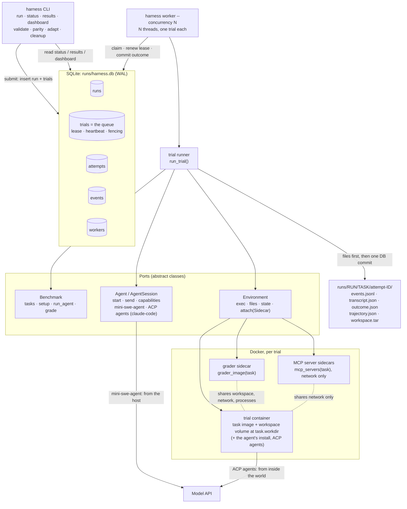

# Agentic Harness

A unified harness for running any agent against any agentic benchmark. Benchmarks and agents plug in through
small adapter classes; each trial (one task × one agent) runs in its own Docker container; runs are queued in
SQLite and executed by background workers, and every result, attempt and trace is persisted.

The core idea: **any agent × any benchmark**. A benchmark adapter says what the tasks are, how to build each
task's world, how to talk to the agent, and how to grade. An agent adapter says how to start a session and send it a
message. The harness owns everything in between: containers, limits, the queue, retries, recording and results.

- [Setup](#setup)
- [Usage](#usage)
- [Architecture](#architecture)
- [Key design decisions](#key-design-decisions)
- [Adding a benchmark or an agent](#adding-a-benchmark-or-an-agent)
- [Project layout and tests](#project-layout-and-tests)
- [Limitations and future work](#limitations-and-future-work)

## Setup

Prerequisites: Python 3.11+, [uv](https://docs.astral.sh/uv/), and Docker running (`open -a Docker` on macOS).

```bash
make init       # git submodules (agents/mini-swe-agent)
make install    # uv sync: creates .venv with the harness and mini-swe-agent
source .venv/bin/activate
```

Create `.env` in the repo root (gitignored; the `harness` CLI loads it on every command):

```bash
ANTHROPIC_API_KEY=sk-ant-...
HARNESS_MODEL=anthropic/claude-haiku-5-5      # the model for every agent (litellm-style); --model overrides it per run
MSWEA_MODEL_NAME=anthropic/claude-haiku-5-5   # only for the starter's `mini` CLI examples; the harness never reads it
MSWEA_CONFIGURED=true                         # skips mini's first-run setup wizard (it hangs or crashes without a TTY)
```

`HARNESS_MODEL` is the one model setting: the harness resolves it (or `--model`) once, at submit time, stores it on
the run, and each agent translates it into its own form (mini passes it to litellm as is; an ACP agent's definition says which variable takes it
and which prefix to drop: Claude Code gets `ANTHROPIC_MODEL` without `anthropic/`). `MSWEA_MODEL_NAME` and `MSWEA_CONFIGURED` only matter for the `mini` CLI used
by the starter examples (`make bash-example`, `make py-example`); the harness drives mini through its Python API.

Optional: `make init-extra-benchmarks` fetches Terminal-Bench, SWE-bench, τ²-bench and MiniWoB++ as submodules
(see [benchmarks/README.md](benchmarks/README.md)). Only Terminal-Bench has an adapter (`terminal-bench`, 3 tasks);
fetch just it with `make init-extra-benchmarks BENCH=benchmarks/terminal-bench`.

## Usage

```
harness run        Submit a run (one queued trial per task); --wait runs it here and prints results
harness worker     Take trials from the queue and run them
harness status     Active and recent runs, or one run's trials
harness results    Accuracy, per-trial table, or full JSON for a run
harness dashboard  Live web view of runs, trials and traces (read-only)
harness validate   Check an adapter's wiring with no real agent: doing nothing must fail, the reference solution must pass
harness parity     Score an agent N times through the harness and N times the benchmark's original way; ranges must overlap
harness adapt      Draft an adapter for a benchmark folder with Claude Code (add-benchmark skill), then validate it
harness cleanup    Remove leftover containers and volumes (--all, --images)
```

Every command's flags: `harness <command> --help`. Agents: `mini-swe-agent` (runs on the host) and any agent that
speaks the [Agent Client Protocol](https://agentclientprotocol.com) (runs inside the task's container): built-in
`claude-code`, or a private agent's own definition file (see [Agents over ACP](#agents-over-acp)). Benchmarks: `bash-operations`, `python-tasks`, `terminal-bench` (needs its
opt-in submodule; without it, `run` and `validate` say which `make` target fetches it).

### Checking an adapter

```bash
harness validate --benchmark bash-operations             # per-task table; exit 1 if any check fails
harness parity --benchmark bash-operations --agent mini-swe-agent --runs 3   # writes runs/parity/<benchmark>-<ts>/parity.json
harness adapt benchmarks/terminal-bench --tasks 3 --model sonnet             # drafts src/agentic_harness/benchmarks/<name>.py + tests
```

`validate` labels each reference solution: **benchmark-provided** (shipped by the benchmark, an independent
check) or **harness-written** (ours, it checks the wiring only). `parity`'s original side runs the benchmark's
own scripts unchanged and the agent in its own Docker mode (mini-swe-agent's `DockerEnvironment`), so the only
difference is our harness. **Adapters drafted by `harness adapt` (or the
[`add-benchmark` skill](.claude/skills/add-benchmark/SKILL.md)) need human review** before their scores are
trusted, even when `validate` passes.

The `terminal-bench` adapter (3 tasks: hello-world, log-summary, sqlite-db-truncate) was drafted this way and then
hand-fixed; see [adapters.md](ideation/adapters.md) for what the draft got right and wrong.

### One command: submit and wait

```bash
harness run --agent agents/mini-swe-agent --benchmark bash-operations --wait
harness run --agent mini-swe-agent --benchmark python-tasks --task_ids py-001,py-002 --wait --concurrency 2
harness run --agent claude-code --benchmark bash-operations --wait
```

`--agent` takes a registry name, a path (its last part is the name), or an ACP agent's `.toml` definition file. `--wait` submits the run, runs an inline
worker for just that run, then prints the results table and summary.

### Queue mode: submit, then work

```bash
harness run --agent agents/mini-swe-agent --benchmark bash-operations    # returns at once
harness run --agent agents/mini-swe-agent --benchmark python-tasks
harness worker --concurrency 3                                           # in another terminal; Ctrl-C to stop
harness worker --concurrency 3 --exit-when-idle                          # or: stop once nothing is left
harness worker --concurrency 4 --max-running 6                           # cap on running trials across ALL workers
```

`harness run` prints `Submitted run <run_id>: ...`. Several workers (processes) can share the queue; each runs
`--concurrency` threads, one trial (one container) per thread. `--max-running N` (or `HARNESS_MAX_RUNNING`; also on
`run --wait`) caps the trials running at once across every worker: a claim only succeeds while fewer than N trials
hold an unexpired lease. `harness run --concurrency` without `--wait` is a usage error (use `harness worker`).
Each worker checks every run once before claiming its work (benchmark known, agent known, agent pre-flight such as
its API key set); a run that fails the check fails on its own, with the reason on each trial, and the other runs
keep flowing.

| Flag | Default | Meaning |
|---|---|---|
| `--model` | `$HARNESS_MODEL` | model for the agent, litellm-style (also on `harness parity`) |
| `--max-run-cost` | none | budget for the whole run, USD: once spent, no more trials start; the rest end `skipped_budget` (trials in flight finish) |

#### Limits: three layers

Each trial's limits are resolved when it runs, in three layers, each overriding the one before:

1. **Harness defaults** (`Limits`, stored with the run).
2. **What the benchmark declares for the task** (`Benchmark.limits(task)`, only the limits it cares about). Terminal-Bench
   declares its `task.yaml` timeouts: `max_agent_timeout_sec` → trial timeout, `max_test_timeout_sec` → grade timeout.
3. **Flags you pass explicitly.** A flag you leave out never overrides anything. A flag that replaces a different
   value the benchmark declares marks the run **non-standard** (`runs.config.non_standard_limits`), noted at submit,
   in `harness results` and on the dashboard: its scores aren't comparable with the benchmark's standard setup.

| Flag | Default | Meaning |
|---|---|---|
| `--trial-timeout` | 600 | seconds per trial (the agent's turns) |
| `--grade-timeout` | 120 | seconds for grading: no grader command runs past it (one started later is a `grader_error`) |
| `--cost-limit` | 1.0 | model spend per trial, USD |
| `--max-steps` | 50 | model calls per trial (an ACP agent only if its definition passes it on: Claude Code's own max turns) |
| `--memory` | 2g | memory per container (`docker --memory`) |
| `--cpus` | 1.0 | CPUs per container (`docker --cpus`) |

Each attempt records the limits it ran under, each with its source (`default` / `benchmark` / `flag`), in
`outcome.json` and `attempts.limits` (`results --format json`); a limit the agent can't keep is marked
`"enforced": false` rather than pretended. The operator controls (`--max-running`, `--concurrency`, `--max-run-cost`)
are not limits: a benchmark can't set them.

### Viewing runs and results

```bash
harness status                          # active runs + runs finished in the last hour (--all: every run)
harness status --run_id <run_id>        # its spend and elapsed time, then one row per trial with cost and time
harness results --run_id <run_id>       # summary (the default); --format table or json
```

Example output (run ids, the in-progress state, token counts and the time breakdown are illustrative; accuracy,
costs and trial times are from a real bash-operations run with mini-swe-agent on Claude Haiku 5.5):

```
$ harness status
RUN                   BENCHMARK        AGENT           PROGRESS    SPEND             ELAPSED  STARTED
20261029-210501-3f2a  bash-operations  mini-swe-agent  3/5 done    $0.0015 of $0.50  31.2s    2026-10-29 21:05:01
20261029-210502-9c1e  python-tasks     mini-swe-agent  setting up  $0.0000           30.4s    2026-10-29 21:05:02

$ harness status --run_id 20261029-210501-3f2a
Run 20261029-210501-3f2a: bash-operations · mini-swe-agent (anthropic/claude-haiku-5-5), 2/5 done, $0.0011 of $0.50 spent, 24.0s elapsed

TASK      STATE    OUTCOME  SCORE  ATTEMPTS  COST     TIME
bash-001  done     graded   True   1         $0.0003  6.3s
bash-002  done     graded   True   1         $0.0005  5.0s
bash-003  running                  2         $0.0003  4.2s
bash-004  pending                  0         $0.0000  0.0s
bash-005  pending                  0         $0.0000  0.0s

$ harness results --run_id 20261029-210501-3f2a --format table
TASK      OUTCOME  SCORE  COST     TOKENS IN/OUT  AGENT  GRADING  TIME  ATTEMPTS
bash-001  graded   True   $0.0003  2,310/118      4.9s   0.9s     6.3s  1
bash-002  graded   True   $0.0005  3,902/201      3.6s   0.9s     5.0s  1
bash-003  graded   False  $0.0007  5,644/260      7.6s   1.0s     9.1s  1
bash-004  graded   True   $0.0005  3,870/190      6.0s   0.9s     7.4s  1
bash-005  graded   True   $0.0004  3,120/164      6.5s   0.9s     7.9s  1

$ harness results --run_id 20261029-210501-3f2a
bash-operations · mini-swe-agent (anthropic/claude-haiku-5-5)   run 20261029-210501-3f2a
Accuracy: 0.80 (n=5 graded, 4 passed)
Excluded: grader_error 0 · infra_error 0 · unsupported 0 · skipped_budget 0
Cost: $0.0025 of $0.50 · $0.0005/task · $0.0006/passing task
Tokens: 18,846 in · 933 out · 17 model calls
Time per trial (avg): env start 0.5s · agent 5.7s · grading 0.9s
Run: setup 14.2s · wall 52.0s (first trial start to last end) · queue wait 16.4s total · 5.8 trials/min
```

Cost is recorded whatever happens: the agent's spend is saved at the end of every turn, also a turn it crashed or
timed out in, so failed and interrupted attempts count toward the run's cost and its `--max-run-cost` budget. Each
attempt stores timestamps at its phase boundaries (queued, claimed, world ready, agent start/end, grading
start/end, finished); every duration above is derived from them.

Known live results with mini-swe-agent on Haiku 5.5: **bash-operations 0.80** (bash-003 fails because its
`input.txt` has no trailing newline, so `wc -l` reports 4 lines, not 5; a benchmark quirk we keep as is) and
**python-tasks 1.00**, about half a cent for both runs together. Claude Code (through ACP) on the same model: bash-operations
0.80 (the same bash-003 miss, $0.0066), python-tasks 1.00 ($0.0055), the same scores as the dedicated adapter it
replaced ([action space](ideation/action-space.md) → Live results).

`--format json` has everything: the run (versions: harness commit, agent commit, dataset and benchmark hashes,
model; config: limits; budget), accuracy, the excluded task ids, every cost, token and time metric of the summary,
and every trial with its raw score and all its attempts (spend and phase timestamps included).

Each attempt also leaves files in `runs/<run_id>/<task_id>/attempt-<attempt_id>/`: `events.jsonl` (the
agent-neutral trace: every message and command), `transcript.json` (the messages), `outcome.json`,
`trajectory.json` (mini's own log; an ACP agent's raw protocol is `acp.jsonl`, its own log `agent-stderr.log`) and `workspace.tar` (the agent's
final workspace, saved before grading).

### Dashboard

```bash
harness dashboard                # http://127.0.0.1:8000/, opens the browser (--port, --no-open)
```

A read-only local page that refreshes every 2 s: every run with its progress and accuracy, a run's trials, and each
attempt's transcript, command trace, error and raw files.

### Cleanup

```bash
harness cleanup                  # labelled containers and volumes (agentic-harness=1) of no running trial
harness cleanup --all            # also those of trials still running
harness cleanup --images         # also cached harness-* images (task images, ACP agents' derived images) no unfinished trial needs
```

A killed worker's containers otherwise live until their keep-alive runs out (3 × trial timeout + grade timeout +
600 s).

## Architecture



An editable version of this diagram is in [`docs/architecture.excalidraw`](docs/architecture.excalidraw) (open it
at [excalidraw.com](https://excalidraw.com)); [`docs/architecture.md`](docs/architecture.md) has the component map
and the queue's state machine.

### How a trial runs

1. **Claim.** A worker thread claims a pending trial in one `BEGIN IMMEDIATE` transaction, creating its attempt row
   and folder; it holds a 120 s lease renewed every 30 s. (A run's first worker first runs `Benchmark.setup()`
   once, e.g. building the task images, then pre-pulls grader and MCP images and builds agent images.)
2. **Capability check.** The agent's `capabilities` (content types, multi-turn, MCP) against
   `Benchmark.requirements(task)`; a gap ends the trial `unsupported` before any world starts.
3. **Start the world.** The runner starts `agent.prepare_image(task.image)` (the task's image; for an ACP agent a
   cached image with the agent's install added) through the `Environment` port (Docker: `sleep` as the main process, a named
   volume at the task's `workdir` (default `/workspace`; Terminal-Bench's `/app`) that starts with the image's own
   files there, memory/CPU/process limits), then the task's MCP servers as network-only sidecars. Commands and
   agents start in the workdir.
4. **Agent turns.** The benchmark drives them in `run_agent`: it sends messages through a recording session, and the
   agent acts on the world until it hands back. Every message and command goes to `events.jsonl`; spend is recorded
   at every turn's end.
5. **Container-death check.** If the world ended during the turn, its `EndReason` decides: the agent killed it or
   exceeded our limits → graded fail; it expired, vanished or the reason is unknown → `infra_error` (retried).
6. **Kill leftovers.** Every process the agent left running is killed, then `workspace.tar` is saved.
7. **Attached grader.** A grader sidecar starts from `grader_image(task)`, sharing the world's workspace, network
   and processes; `grade()` runs the benchmark's own grader there and returns a `Score`, within the grade timeout
   (a command with no timeout gets the rest of it). The grader's files never enter the agent's world.
8. **Outcome.** `graded`, `grader_error`, `infra_error` (with `retryable`) or `unsupported`.
9. **Files, then DB.** `outcome.json` and `transcript.json` are written (redacted, atomically), then one fenced
   transaction records the outcome and either finishes the trial or re-queues it with a backoff. The world and its
   sidecars (grader, MCP servers) are always stopped.

## Key design decisions

- **Ports and adapters.** The runner only knows `Benchmark`, `Agent` and `Environment`; Docker is one injected
  backend. ([audit](ideation/audit-2026-10-29.md), [environment](ideation/environment.md))
- **Benchmark-driven turns.** `run_agent` drives the conversation: single-shot is one `send()`, multi-step or
  simulated-user benchmarks loop. ([task-input](ideation/task-input.md))
- **Fidelity.** Adapters reuse the benchmark's own setup and grader scripts (setup baked into the task image); the
  harness adds nothing to prompts. ([fidelity vs integrity](ideation/fidelity-vs-integrity.md),
  [task-input](ideation/task-input.md))
- **Attached grader sidecar.** Grading gets its own tools (e.g. python for an alpine task) and still sees the
  world's files, `localhost` and processes; nothing is installed at grade time.
  ([environment and grading](ideation/environment-and-grading.md))
- **Outcome model.** `graded` / `grader_error` / `infra_error` / `unsupported`; accuracy is the mean over `graded`
  only, the rest are always reported; only a retryable `infra_error` is retried (up to 3 attempts).
  ([errors](ideation/errors.md))
- **Queue in the trials table.** No separate jobs table: atomic claim, leases with heartbeats, fenced writes, lost
  workers reclaimed, retries as new attempt rows. ([database](ideation/database.md),
  [one job per trial](ideation/trial-phases.md))
- **Per-container resource limits.** `--memory`, `--cpus`, `--pids-limit`; going over them is the agent's
  failure, not infra. ([environment](ideation/environment.md))
- **Credentials.** An allowlist at the container boundary (an agent's `forward_env`, injected at exec time, never
  in image layers) and redaction in every trace, file and DB row: `.env` secrets, secret-named variables in the
  harness's environment, and every forwarded variable. mini runs on the host, so its
  key never enters a container. ([security](ideation/security.md))
- **MCP as the action layer beyond the shell.** Tools a benchmark exposes as MCP servers in network-only sidecars,
  so agents keep their own loop; one capability check decides `unsupported` (mini is bash-only; ACP agents get the
  servers in `session/new`). ([action space](ideation/action-space.md))
- **Agents inside or outside the world.** mini runs on the host and acts through our `exec`; agents that speak ACP
  (Claude Code, and any private agent, as data: no per-agent code) run inside the world from a cached derived image,
  spoken to over `docker exec -i`, their key passed per process. One model setting (`HARNESS_MODEL` /
  `--model`) for every agent. ([action space](ideation/action-space.md), [agents and runner](ideation/agents-and-runner.md))
- **Cost is always recorded.** Spend is saved at every turn's end, also on crash, timeout or Ctrl-C; a run budget
  stops new trials. ([database](ideation/database.md) #20–23)
- **Adapters are checked, not trusted.** `validate` (null + oracle agents), `parity` (scores vs the benchmark's
  original workflow), and `adapt` (Claude Code drafts, validate gates, a human reviews). ([adapters](ideation/adapters.md))
- **Integrity = trace + saved workspace.** Every command and the final workspace are on record; no
  benchmark-specific tamper checks. ([fidelity vs integrity](ideation/fidelity-vs-integrity.md))

## Adding a benchmark or an agent

**A benchmark**: subclass `Benchmark[YourTask]` (see
[`benchmarks/bash_operations.py`](src/agentic_harness/benchmarks/bash_operations.py)) and add it to `BENCHMARKS`
in [`benchmarks/__init__.py`](src/agentic_harness/benchmarks/__init__.py).

| Method | Required | What it does |
|---|---|---|
| `name` | yes | registry key, e.g. `"bash-operations"` |
| `tasks()` | yes | every task, as a `Task` subclass carrying the benchmark's native fields and an `image` (and, keyword-only, a `workdir`: default `/workspace`); raise `BenchmarkUnavailable` if its data isn't on disk |
| `run_agent(task, agent, env)` | yes | drive the turns; usually one `agent.send(Message("user", (Text(...),)))` |
| `grade(task, grader, env, transcript)` | yes | run the benchmark's grader in `grader`, return a `Score`; raise `GraderError` on unreadable output |
| `setup(tasks)` | no | once per run: build/pull images (`build_image`, `ensure_image` from `agentic_harness.environments`) |
| `grader_image(task)` | no | the grader's image; default `task.image` |
| `limits(task)` | no | the limits the benchmark declares for the task (`LimitOverrides`, e.g. its own timeouts); explicit run flags still override them; default none |
| `requirements(task)` | no | what the agent must support (`AgentCapabilities`); default text, single turn, MCP iff it declares servers |
| `mcp_servers(task)` | no | `McpServer`s (name, image, command, port) the runner starts as network-only sidecars; default none |
| `version()` | no | content hash of what builds the images; put it in image tags |
| `score_to_float(score)` | no | override the Inspect-style default (`True`/`"C"` → 1, `"P"` → 0.5, ...) |
| `reference_solution(task)` | no | a known-good answer for `harness validate` (`ReferenceSolution`; the benchmark's own if it ships one) |
| `original_workflow(task, agent, model, out_dir)` | no | the benchmark's original way to run a task, for `harness parity` |

The full rules (and a Claude Code skill that follows them) are in
[`.claude/skills/add-benchmark/SKILL.md`](.claude/skills/add-benchmark/SKILL.md); iterate until `harness validate` passes.

### Agents over ACP

An agent that speaks the [Agent Client Protocol](https://agentclientprotocol.com) (Claude Code, Codex, Gemini CLI,
Copilot CLI, goose, OpenCode, ... see the [ACP agent list](https://agentclientprotocol.com/overview/agents)) needs
**no code**: one generic adapter ([`agents/acp.py`](src/agentic_harness/agents/acp.py)) runs it inside the trial's
world and speaks ACP to it over `docker exec -i` (one session per trial, one `session/prompt` per turn; the agent
uses its own tools; permission requests are allowed, once, inside the sandbox; `session/update` notifications become
the trace; cost comes from its `usage_update`). An agent is a definition: built-ins in
[`agents/acp_agents.toml`](src/agentic_harness/agents/acp_agents.toml); a private one is a file of its own, so its
code never enters this repo:

```toml
# my-agent.toml  →  harness run --agent my-agent.toml --benchmark bash-operations --wait
version = "my-agent 1.4.2"                      # recorded in runs.versions
install_dir = "/opt/my-agent"                   # a self-contained install, copied into the task's image
install.any = { from = "registry.example.com/my-agent:1.4.2" }   # the image it is copied from (or install.musl /
                                                # install.glibc = { from = "<builder image>", run = "<shell>" })
world_setup = ""                                # optional shell run in the world's image afterwards
command = ["/opt/my-agent/bin/my-agent", "--acp"]  # speaks ACP on stdin/stdout
forward_env = ["MY_AGENT_API_KEY"]              # host variables it gets (redacted everywhere)
env = { MY_AGENT_TELEMETRY = "off" }            # fixed variables
model_env = "MY_AGENT_MODEL"                    # gets the run's model (--model / HARNESS_MODEL) ...
model_prefix = "openai/"                        # ... without this prefix
capabilities = { content_types = ["text"], mcp = true }   # what the runner checks tasks against
```

Limits: the deadline (`session/cancel`, then kill) and the cost budget (cancel once the reported cost passes it).
ACP has no step count; an agent that keeps a step limit itself gets it through `limits_meta` (a limit → a dotted path in
`session/new`'s `_meta`). Claude Code: `limits_meta = { max_steps = "claudeCode.options.maxTurns" }`, its own max
turns (API round trips), counted per prompt. Without it, `--max-steps` isn't enforced and the attempt says so
(`"enforced": false`); the same for `command_timeout_s`, since the agent runs its own commands.

### An agent with code of its own

**An agent**: subclass `Agent` and `AgentSession` (see
[`agents/mini_swe_agent.py`](src/agentic_harness/agents/mini_swe_agent.py)) and add `"name": "module:Class"` to
`AGENTS` in [`agents/__init__.py`](src/agentic_harness/agents/__init__.py) (imported lazily).

| Method | Required | What it does |
|---|---|---|
| `Agent.name` | yes | registry key |
| `Agent.capabilities` | no | `AgentCapabilities(content_types, multi_turn, mcp)`; default: one text message |
| `Agent.forward_env` | no | host variables (e.g. its API key) it passes into the world per command; their values are redacted |
| `Agent.native_model()` | no | the run's litellm-style model in the agent's own form (default: as is) |
| `Agent.start(env, artifacts_dir, limits, mcp_servers)` | yes | a fresh session that acts only through `env` and stops within `limits` |
| `Agent.prepare_image(task_image)` / `image_for` | no | an agent that runs inside the world returns a derived image (default: the task's) |
| `AgentSession.send(message)` | yes | give the agent a message, block until it hands back, return its reply |
| `AgentSession.stats()` | no | exit status, cost, model calls, input/output tokens for the records (also after a crash) |
| `AgentSession.new_events()` | no | trace events the agent produced itself (e.g. an ACP agent's tool calls, which bypass our `exec`) |
| `Agent.preflight()` | no | cheap check at submit, and once per run in each worker (model known, key set); a run that fails it fails alone |
| `Agent.version()` | no | recorded in `runs.versions` |

Raise `Unsupported` for content the agent can't take, `AgentLimitation` when the agent itself can't go on (the
world is then graded as is), and `TransientError` for provider or network blips (retried).

## Project layout and tests

```
.
├── src/agentic_harness/
│   ├── cli.py                 # harness run / worker / status / results / dashboard / validate / parity / adapt / cleanup
│   ├── dashboard.py           # read-only web server for dashboard/ (127.0.0.1, SQLite opened read-only)
│   ├── worker.py              # worker threads: claim, setup, attempt, lease heartbeat
│   ├── store.py               # SQLite schema and every query (handwritten SQL)
│   ├── metrics.py             # cost and time metrics for results, derived from the rows
│   ├── runner.py              # run_trial: one attempt, start to finish
│   ├── recording.py           # RecordingSession / RecordingEnvironment → events.jsonl
│   ├── redact.py              # secret redaction
│   ├── types.py               # Task, Message, Score, Limits, Outcome, ReferenceSolution
│   ├── paths.py               # REPO_ROOT, RUNS_DIR, DB_PATH
│   ├── validate.py            # harness validate: null + oracle checks through run_trial
│   ├── parity.py, original.py # harness parity: statistics; the original way (agent's own Docker mode)
│   ├── benchmarks/            # Benchmark ABC, bash_operations.py, python_tasks.py, terminal_bench.py, registry
│   ├── agents/                # Agent / AgentSession ABCs, mini_swe_agent.py, acp.py + acp_agents.toml (ACP agents, over the agent-client-protocol library), fake.py, registry
│   └── environments/          # Environment ABC, docker.py
├── .claude/skills/add-benchmark/  # the adapter rules, as a Claude Code skill (harness adapt uses it)
├── dashboard/                 # the dashboard page: React + htm from a CDN, no build step
├── benchmarks/                # bash-operations, python-tasks (+ opt-in upstream submodules, e.g. terminal-bench)
├── agents/mini-swe-agent/     # submodule
├── tests/                     # pytest (Docker required); fixtures/mcp-server: a tiny MCP server image
├── docs/                      # architecture.md, architecture.excalidraw
├── examples/                  # the starter's mini CLI examples
├── ideation/                  # design notes: one per decision area
└── runs/                      # harness.db + attempt folders (gitignored)
```

```bash
.venv/bin/python -m pytest -q                      # Docker must be running; no model calls
RUN_LIVE=1 .venv/bin/python -m pytest -q -m live   # also calls a real model (needs ANTHROPIC_API_KEY)
```

The runner's outcome rules are also tested without Docker against a fake environment (`tests/test_runner_rules.py`).

## Limitations and future work

**Not built (designed or noted, see `ideation/`; list: [implementation plan](ideation/implementation-plan.md) → Remaining)**

- τ²-bench via an MCP sidecar built from τ²'s own code (domain tools + simulated user + τ²'s evaluator), the
  Harbor tau3 pattern.
- GUI / desktop benchmarks (OSWorld, MiniWoB++): need a display in the world and tools beyond the shell.
- Multi-machine workers: SQLite → Postgres (SQLAlchemy Core + Alembic); the claim and lease logic carries over.
- Pipelined grading: a separate grading pool so agent slots free up while slow graders run.
- Network as a benchmark-declared world property (offline worlds, a model-API-only allowlist for in-world agents).
- The unprivileged `agent` user (agents run as root in the world today).
- `harness cancel`, `harness regrade`.
- Parity beyond mini-swe-agent: no `original_workflow` for ACP agents, nor for Terminal-Bench (so no parity run
  for Terminal-Bench yet).
- Adapters for the other vendored upstream benchmarks (SWE-bench, τ²-bench, MiniWoB++).

**Known gaps**

- A timed-out command keeps running inside the container until the pre-grade kill (repeated `/proc` passes, at
  most 5).
- A fork bomb that fills `--pids-limit` can stop `docker exec` from starting, so the pre-grade kill may not run
  (grading still starts: the grader is its own container).
- ACP agents: a step limit only where the agent keeps one itself (Claude Code: per prompt, so a multi-turn benchmark
  gets it per turn); ACP reports no model calls, so `model_calls` is 0. Provider errors are classified by
  their message's words (ACP has no error kinds), and cost is only what the agent reports (Claude Code does; for one
  that doesn't, a model-traffic proxy would be the general fix).
- An ACP agent's API key is inside the world while it runs (the agent could read it); it is never in an image layer,
  on the host command line, or in our logs.
- Our `MiniSweAgent` runs commands with `sh -c` where mini's own Docker mode uses `bash -lc`, a difference
  `harness parity` exposed and left open ([adapters](ideation/adapters.md) → Built).
- Terminal-Bench's own `run-tests.sh` installs curl and uv from the network at grade time, so grading those tasks
  needs internet (kept as the benchmark ships it; a failed download is a `grader_error`).
- mini's own retry backoff (4-60 s between attempts) can still run past the trial deadline; each model call is
  capped to the time left, and none starts after it.
- No migrations: a schema change means deleting `runs/harness.db`.
- `harness cleanup` treats every container labelled `agentic-harness=1` that isn't a live attempt's as leftover,
  including one started by hand with that label (the test suite labels its own differently, per test module).
