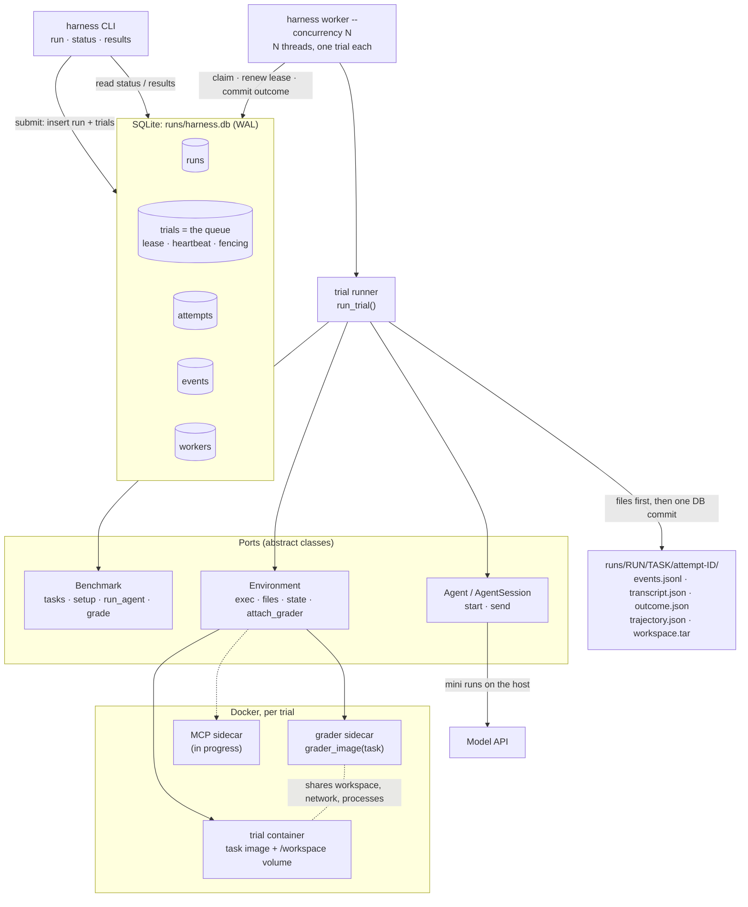

# Agentic Harness

A unified harness for running any agent against any agentic benchmark. Benchmarks and agents plug in through
small adapter classes; each trial (one task × one agent) runs in its own Docker container; runs are queued in
SQLite and executed by background workers, and every result, attempt and trace is persisted.

The core idea: **any agent × any benchmark**. A benchmark adapter says what the tasks are, how to build each
task's world, how to talk to the agent, and how to grade. An agent adapter says how to start a session and send it a
message. The harness owns everything in between: containers, limits, the queue, retries, recording and results.

- [Setup](#setup)
- [Usage](#usage)
- [Architecture](#architecture)
- [Key design decisions](#key-design-decisions)
- [Adding a benchmark or an agent](#adding-a-benchmark-or-an-agent)
- [Project layout and tests](#project-layout-and-tests)
- [Limitations and future work](#limitations-and-future-work)

## Setup

Prerequisites: Python 3.11+, [uv](https://docs.astral.sh/uv/), and Docker running (`open -a Docker` on macOS).

```bash
make init       # git submodules (agents/mini-swe-agent)
make install    # uv sync: creates .venv with the harness and mini-swe-agent
source .venv/bin/activate
```

Create `.env` in the repo root (gitignored; the `harness` CLI loads it on every command):

```bash
ANTHROPIC_API_KEY=sk-ant-...
MSWEA_MODEL_NAME=anthropic/claude-haiku-5-5   # mini-swe-agent's default model; --model overrides it per run
MSWEA_CONFIGURED=true                         # skips mini's first-run setup wizard (it hangs or crashes without a TTY)
```

`MSWEA_MODEL_NAME` is mini-swe-agent's own setting; the harness resolves it once, at submit time, and stores it on
the run. `MSWEA_CONFIGURED` only matters for the `mini` CLI used by the starter examples (`make bash-example`,
`make py-example`); the harness drives mini through its Python API.

Optional: `make init-extra-benchmarks` fetches Terminal-Bench, SWE-bench, τ²-bench and MiniWoB++ as submodules
(no adapters for them yet; see [benchmarks/README.md](benchmarks/README.md)).

## Usage

```
harness run        Submit a run (one queued trial per task); --wait runs it here and prints results
harness worker     Take trials from the queue and run them
harness status     Active and recent runs, or one run's trials
harness results    Accuracy, per-trial table, or full JSON for a run
harness dashboard  Live web view of runs, trials and traces (read-only)
```

### One command: submit and wait

```bash
harness run --agent agents/mini-swe-agent --benchmark bash-operations --wait
harness run --agent mini-swe-agent --benchmark python-tasks --task_ids py-001,py-002 --wait --concurrency 2
```

`--agent` takes a registry name or a path (its last part is the name). `--wait` submits the run, runs an inline
worker for just that run, then prints the results table and summary.

### Queue mode: submit, then work

```bash
harness run --agent agents/mini-swe-agent --benchmark bash-operations    # returns at once
harness run --agent agents/mini-swe-agent --benchmark python-tasks
harness worker --concurrency 3                                           # in another terminal; Ctrl-C to stop
harness worker --concurrency 3 --exit-when-idle                          # or: stop once nothing is left
```

`harness run` prints `Submitted run <run_id>: ...`. Several workers (processes) can share the queue; each runs
`--concurrency` threads, one trial (one container) per thread.

Per-run limits (stored with the run; defaults shown):

| Flag | Default | Meaning |
|---|---|---|
| `--model` | `$MSWEA_MODEL_NAME` | model for the agent |
| `--trial-timeout` | 600 | seconds per trial |
| `--cost-limit` | 1.0 | model spend per trial, USD |
| `--max-run-cost` | none | budget for the whole run, USD: once spent, no more trials start; the rest end `skipped_budget` (trials in flight finish) |
| `--max-steps` | 50 | model calls per trial |
| `--memory` | 2g | memory per container (`docker --memory`) |
| `--cpus` | 1.0 | CPUs per container (`docker --cpus`) |

### Viewing runs and results

```bash
harness status                          # active runs + runs finished in the last hour (--all: every run)
harness status --run_id <run_id>        # its spend and elapsed time, then one row per trial with cost and time
harness results --run_id <run_id>       # summary (the default); --format table or json
```

Example output (run ids, the in-progress state, token counts and the time breakdown are illustrative; accuracy,
costs and trial times are from a real bash-operations run with mini-swe-agent on Claude Haiku 5.5):

```
$ harness status
RUN                   BENCHMARK        AGENT           PROGRESS    SPEND             ELAPSED  STARTED
20261029-210501-3f2a  bash-operations  mini-swe-agent  3/5 done    $0.0015 of $0.50  31.2s    2026-10-29 21:05:01
20261029-210502-9c1e  python-tasks     mini-swe-agent  setting up  $0.0000           30.4s    2026-10-29 21:05:02

$ harness status --run_id 20261029-210501-3f2a
Run 20261029-210501-3f2a: bash-operations · mini-swe-agent (anthropic/claude-haiku-5-5), 2/5 done, $0.0011 of $0.50 spent, 24.0s elapsed

TASK      STATE    OUTCOME  SCORE  ATTEMPTS  COST     TIME
bash-001  done     graded   True   1         $0.0003  6.3s
bash-002  done     graded   True   1         $0.0005  5.0s
bash-003  running                  2         $0.0003  4.2s
bash-004  pending                  0         $0.0000  0.0s
bash-005  pending                  0         $0.0000  0.0s

$ harness results --run_id 20261029-210501-3f2a --format table
TASK      OUTCOME  SCORE  COST     TOKENS IN/OUT  AGENT  GRADING  TIME  ATTEMPTS
bash-001  graded   True   $0.0003  2,310/118      4.9s   0.9s     6.3s  1
bash-002  graded   True   $0.0005  3,902/201      3.6s   0.9s     5.0s  1
bash-003  graded   False  $0.0007  5,644/260      7.6s   1.0s     9.1s  1
bash-004  graded   True   $0.0005  3,870/190      6.0s   0.9s     7.4s  1
bash-005  graded   True   $0.0004  3,120/164      6.5s   0.9s     7.9s  1

$ harness results --run_id 20261029-210501-3f2a
bash-operations · mini-swe-agent (anthropic/claude-haiku-5-5)   run 20261029-210501-3f2a
Accuracy: 0.80 (n=5 graded, 4 passed)
Excluded: grader_error 0 · infra_error 0 · unsupported 0 · skipped_budget 0
Cost: $0.0025 of $0.50 · $0.0005/task · $0.0006/passing task
Tokens: 18,846 in · 933 out · 17 model calls
Time per trial (avg): env start 0.5s · agent 5.7s · grading 0.9s
Run: setup 14.2s · wall 52.0s (first trial start to last end) · queue wait 16.4s total · 5.8 trials/min
```

Cost is recorded whatever happens: the agent's spend is saved at the end of every turn, also a turn it crashed or
timed out in, so failed and interrupted attempts count toward the run's cost and its `--max-run-cost` budget. Each
attempt stores timestamps at its phase boundaries (queued, claimed, world ready, agent start/end, grading
start/end, finished); every duration above is derived from them.

Known live results with mini-swe-agent on Haiku 5.5: **bash-operations 0.80** (bash-003 fails because its
`input.txt` has no trailing newline, so `wc -l` reports 4 lines, not 5; a benchmark quirk we keep as is) and
**python-tasks 1.00**, about half a cent for both runs together.

`--format json` has everything: the run (versions: harness commit, agent commit, dataset and benchmark hashes,
model; config: limits; budget), accuracy, the excluded task ids, every cost, token and time metric of the summary,
and every trial with its raw score and all its attempts (spend and phase timestamps included).

Each attempt also leaves files in `runs/<run_id>/<task_id>/attempt-<attempt_id>/`: `events.jsonl` (the
agent-neutral trace: every message and command), `transcript.json` (the messages), `outcome.json`,
`trajectory.json` (mini's own log) and `workspace.tar` (the agent's final workspace, saved before grading).

### Dashboard

```bash
harness dashboard                # http://127.0.0.1:8000/, opens the browser (--port, --no-open)
```

A read-only local page that refreshes every 2 s: every run with its progress and accuracy, a run's trials, and each
attempt's transcript, command trace, error and raw files.

## Architecture



An editable version of this diagram is in [`docs/architecture.excalidraw`](docs/architecture.excalidraw) (open it
at [excalidraw.com](https://excalidraw.com)); [`docs/architecture.md`](docs/architecture.md) has the component map
and the queue's state machine.

### How a trial runs

1. **Claim.** A worker thread claims a pending trial in one `BEGIN IMMEDIATE` transaction, creating its attempt row
   and folder; it holds a 120 s lease renewed every 30 s. (A run's first worker first runs `Benchmark.setup()`
   once, e.g. building the task images.)
2. **Start the world.** The runner starts the task's image through the `Environment` port (Docker: `sleep` as the
   main process, a named `/workspace` volume, memory/CPU/process limits).
3. **Agent turns.** The benchmark drives them in `run_agent`: it sends messages through a recording session, and the
   agent acts on the world until it hands back. Every message and command goes to `events.jsonl`.
4. **Container-death check.** If the world ended during the turn, its `EndReason` decides: the agent killed it or
   exceeded our limits → graded fail; it expired, vanished or the reason is unknown → `infra_error` (retried).
5. **Kill leftovers.** Every process the agent left running is killed, then `workspace.tar` is saved.
6. **Attached grader.** A grader sidecar starts from `grader_image(task)`, sharing the world's workspace, network
   and processes; `grade()` runs the benchmark's own grader there and returns a `Score`. The grader's files never
   enter the agent's world.
7. **Outcome.** `graded`, `grader_error`, `infra_error` (with `retryable`) or `unsupported`.
8. **Files, then DB.** `outcome.json` and `transcript.json` are written (redacted, atomically), then one fenced
   transaction records the outcome and either finishes the trial or re-queues it with a backoff. Both containers
   are always stopped.

## Key design decisions

- **Ports and adapters.** The runner only knows `Benchmark`, `Agent` and `Environment`; Docker is one injected
  backend. ([audit](ideation/audit-2026-10-29.md), [environment](ideation/environment.md))
- **Benchmark-driven turns.** `run_agent` drives the conversation: single-shot is one `send()`, multi-step or
  simulated-user benchmarks loop. ([task-input](ideation/task-input.md))
- **Fidelity.** Adapters reuse the benchmark's own setup and grader scripts (setup baked into the task image); the
  harness adds nothing to prompts. ([fidelity vs integrity](ideation/fidelity-vs-integrity.md),
  [task-input](ideation/task-input.md))
- **Attached grader sidecar.** Grading gets its own tools (e.g. python for an alpine task) and still sees the
  world's files, `localhost` and processes; nothing is installed at grade time.
  ([environment and grading](ideation/environment-and-grading.md))
- **Outcome model.** `graded` / `grader_error` / `infra_error` / `unsupported`; accuracy is the mean over `graded`
  only, the rest are always reported; only a retryable `infra_error` is retried (up to 3 attempts).
  ([errors](ideation/errors.md))
- **Queue in the trials table.** No separate jobs table: atomic claim, leases with heartbeats, fenced writes, lost
  workers reclaimed, retries as new attempt rows. ([database](ideation/database.md),
  [one job per trial](ideation/trial-phases.md))
- **Per-container resource limits.** `--memory`, `--cpus`, `--pids-limit`; going over them is the agent's
  failure, not infra. ([environment](ideation/environment.md))
- **Credentials.** An allowlist at the container boundary (an agent's `forward_env`, injected at exec time, never
  in image layers) and redaction of `.env` secrets in every trace, file and DB row. mini runs on the host, so its
  key never enters a container. ([security](ideation/security.md))
- **MCP as the action layer beyond the shell.** Tools a benchmark exposes (browser, GUI) as MCP servers in a
  sidecar, so agents keep their own loop. In progress. ([action space](ideation/action-space.md))
- **Integrity = trace + saved workspace.** Every command and the final workspace are on record; no
  benchmark-specific tamper checks. ([fidelity vs integrity](ideation/fidelity-vs-integrity.md))

## Adding a benchmark or an agent

**A benchmark**: subclass `Benchmark[YourTask]` (see
[`benchmarks/bash_operations.py`](src/agentic_harness/benchmarks/bash_operations.py)) and add it to `BENCHMARKS`
in [`benchmarks/__init__.py`](src/agentic_harness/benchmarks/__init__.py).

| Method | Required | What it does |
|---|---|---|
| `name` | yes | registry key, e.g. `"bash-operations"` |
| `tasks()` | yes | every task, as a `Task` subclass carrying the benchmark's native fields and an `image` |
| `run_agent(task, agent, env)` | yes | drive the turns; usually one `agent.send(Message("user", (Text(...),)))` |
| `grade(task, grader, env, transcript)` | yes | run the benchmark's grader in `grader`, return a `Score`; raise `GraderError` on unreadable output |
| `setup(tasks)` | no | once per run: build/pull images (`build_image`, `ensure_image` from `agentic_harness.environments`) |
| `grader_image(task)` | no | the grader's image; default `task.image` |
| `version()` | no | content hash of what builds the images; put it in image tags |
| `score_to_float(score)` | no | override the Inspect-style default (`True`/`"C"` → 1, `"P"` → 0.5, ...) |

**An agent**: subclass `Agent` and `AgentSession` (see
[`agents/mini_swe_agent.py`](src/agentic_harness/agents/mini_swe_agent.py)) and add `"name": "module:Class"` to
`AGENTS` in [`agents/__init__.py`](src/agentic_harness/agents/__init__.py) (imported lazily).

| Method | Required | What it does |
|---|---|---|
| `Agent.name`, `Agent.model_env` | yes / no | registry key; the env var holding its default model |
| `Agent.start(env, artifacts_dir, limits)` | yes | a fresh session that acts only through `env` and stops within `limits` |
| `AgentSession.send(message)` | yes | give the agent a message, block until it hands back, return its reply |
| `AgentSession.stats()` | no | exit status, cost, model calls, input/output tokens for the records (also after a crash) |
| `Agent.preflight()` | no | cheap check at submit and worker start (model known, key set) |
| `Agent.version()` | no | recorded in `runs.versions` |

Raise `Unsupported` for content the agent can't take, `AgentLimitation` when the agent itself can't go on (the
world is then graded as is), and `TransientError` for provider or network blips (retried).

## Project layout and tests

```
.
├── src/agentic_harness/
│   ├── cli.py                 # harness run / worker / status / results / dashboard
│   ├── dashboard.py           # read-only web server for dashboard/ (127.0.0.1, SQLite opened read-only)
│   ├── worker.py              # worker threads: claim, setup, attempt, lease heartbeat
│   ├── store.py               # SQLite schema and every query (handwritten SQL)
│   ├── runner.py              # run_trial: one attempt, start to finish
│   ├── recording.py           # RecordingSession / RecordingEnvironment → events.jsonl
│   ├── redact.py              # secret redaction
│   ├── types.py               # Task, Message, Score, Limits, Outcome
│   ├── benchmarks/            # Benchmark ABC, bash_operations.py, python_tasks.py, registry
│   ├── agents/                # Agent / AgentSession ABCs, mini_swe_agent.py, registry
│   └── environments/          # Environment ABC, docker.py
├── dashboard/                 # the dashboard page: React + htm from a CDN, no build step
├── benchmarks/                # bash-operations, python-tasks (+ opt-in upstream submodules)
├── agents/mini-swe-agent/     # submodule
├── tests/                     # pytest (Docker required)
├── docs/                      # architecture.md, architecture.excalidraw
├── examples/                  # the starter's mini CLI examples
├── ideation/                  # design notes: one per decision area, plus progress.md
└── runs/                      # harness.db + attempt folders (gitignored)
```

```bash
.venv/bin/python -m pytest -q                      # Docker must be running; no model calls
RUN_LIVE=1 .venv/bin/python -m pytest -q -m live   # also calls a real model (needs ANTHROPIC_API_KEY)
```

The runner's outcome rules are also tested without Docker against a fake environment (`tests/test_runner_rules.py`).

## Limitations and future work

**In progress**

- Claude Code agent adapter (`claude -p`, resumed with `--resume` for multi-turn).
- MCP tool servers as the action layer beyond the shell.

**Not built (designed, see `ideation/`)**

- GUI / desktop benchmarks (OSWorld, MiniWoB++): need a display in the world and tools beyond the shell.
- Multi-machine workers: SQLite → Postgres (SQLAlchemy Core + Alembic); the claim and lease logic carries over.
- Pipelined grading: a separate grading pool so agent slots free up while slow graders run.
- `harness validate` (null and oracle agents check an adapter's wiring) and `harness parity` (scores match the
  benchmark's original harness).
- τ²-bench via an MCP sidecar built from τ²'s own code (domain tools + simulated user + τ²'s evaluator), the
  Harbor tau3 pattern.
- Adapters for the other vendored upstream benchmarks.

**Known gaps**

- The pre-grade kill is a single pass over `/proc`; a process that keeps forking can slip through.
- A timed-out command keeps running inside the container until that pre-grade kill.
- No `harness cleanup` / `harness cancel`: a killed worker's containers live until their lifetime runs out (find
  them with `docker ps --filter label=agentic-harness=1`).
- No migrations: a schema change means deleting `runs/harness.db`.
- Agents run as root in the world; the unprivileged `agent` user is designed, not built.
