# Architecture

The diagram and the trial walkthrough are in the [README](../README.md#architecture); an editable copy of the
diagram is [`architecture.excalidraw`](architecture.excalidraw) (open at [excalidraw.com](https://excalidraw.com)).
This page adds the component map, the queue's state machines, and where data lives. Design reasoning lives in
[`ideation/`](../ideation/).

## Components

| Component | Code | Responsibility |
|---|---|---|
| CLI | `cli.py` | Validates and submits runs (agent pre-flight, model resolved, limits and versions stored); reads status and results; `cleanup`. Runs trials itself only in `run --wait` (an inline worker), `validate` and `parity` |
| Dashboard | `dashboard.py`, `dashboard/` | `harness dashboard`: a standard-library HTTP server on 127.0.0.1 reading the DB (opened read-only) and attempt folders; a React + htm page, no build step |
| Worker | `worker.py` | N threads per process. Each loop: check new runs once (benchmark and agent known, agent pre-flight; a run that fails fails alone) → reclaim expired leases → claim a run's setup or a trial (with `--max-running`, only while fewer trials run across all workers) → run it under a lease heartbeat → commit the outcome |
| Store | `store.py` | The SQLite schema and every query: atomic claims, fenced writes, retries, spend and the run budget, accuracy |
| Metrics | `metrics.py` | Cost and time metrics for `results`, derived from the attempts' spend and phase timestamps |
| Trial runner | `runner.py` | One attempt start to finish; turns every failure into an `Outcome` (never raises) |
| Recording | `recording.py` | Wraps the agent session and the agent's world; appends every message and command to `events.jsonl` |
| Redaction | `redact.py` | Masks secrets in everything written: `.env` values, secret-named environment variables, every variable an agent forwards into its world |
| Benchmark port | `benchmarks/base.py` | `tasks`, `setup`, `run_agent`, `grade`; optional `grader_image`, `requirements`, `mcp_servers`, `version`, `score_to_float`, `reference_solution`, `original_workflow` |
| Benchmarks | `benchmarks/` | `bash-operations`, `python-tasks`, `terminal-bench` (3 tasks, drafted by `harness adapt`) |
| Agent port | `agents/base.py` | `Agent.start` → `AgentSession.send`; `capabilities`, `forward_env`, `prepare_image` / `image_for`, `native_model`, `preflight`, `version`, `stats`, `new_events`; the agent-side exceptions |
| Agents | `agents/` | `mini-swe-agent` (on the host, acts through our `exec`), `claude-code` (inside the world, cached derived image); `fake.py`: `NullAgent` / `OracleAgent` for `validate` (not in `AGENTS`) |
| Environment port | `environments/base.py` | `exec` (with `env=`, `user=`), file transfer, `state` (+ `EndReason`), `kill_agent_processes`, `save_workspace`, `attach(Sidecar)` / `attach_grader` |
| Docker backend | `environments/docker.py` | The `docker` CLI via `subprocess`: containers, named workspace volumes (mounted at the task's `workdir`, starting with the image's files there), limits, grader and MCP sidecars, image builds and pulls |
| Adapter checks | `validate.py`, `parity.py`, `original.py` | `harness validate` (null + oracle agents through `run_trial`); `harness parity` (statistics; the benchmark's original way with mini's own Docker mode). `harness adapt` (in `cli.py`) runs `claude -p` with `.claude/skills/add-benchmark/SKILL.md` |

Dependencies point inward: the runner imports only the three ports, and the worker injects the backend
(`ENVIRONMENT = DockerEnvironment`). The agent registry is lazy, so `status` / `results` never import the agent's
libraries.

## Queue state machines

A run:

```mermaid
stateDiagram-v2
  [*] --> pending: harness run
  pending --> running: a worker claims setup (leased) and Benchmark.setup() succeeds
  pending --> failed: setup raises (setup.log saved; every trial ends infra_error)
  pending --> failed: a worker's pre-flight check of the run fails (unknown benchmark or agent, key missing)
  running --> failed: the same check, in a worker started later (every trial not done ends infra_error)
  running --> done: last trial done
  running --> done: budget (--max-run-cost) spent and nothing in flight (waiting trials end skipped_budget)
```

A trial (the queue unit):

```mermaid
stateDiagram-v2
  [*] --> pending: harness run
  pending --> running: claim (BEGIN IMMEDIATE; new attempt row + folder; 120 s lease)
  running --> running: heartbeat renews the lease every 30 s
  running --> done: graded / grader_error / unsupported / non-retryable infra_error / 3rd attempt
  running --> pending: retryable infra_error, available_at = now + 5 s x attempt
  running --> pending: lease expired (worker lost): attempt closed as infra_error by another worker
  running --> pending: worker interrupted (Ctrl-C / SIGTERM): attempt closed as retryable infra_error
  pending --> done: run budget spent before it started (skipped_budget, no attempt)
  pending --> done: its run failed a worker's pre-flight check (infra_error, not retried)
  running --> done: the same; the worker running it loses its claim
```

Every write that ends an attempt or renews a lease is fenced on `claimed_by` and `attempt_count`, so a worker that
lost its lease (killed, hung, laptop asleep) can't overwrite the attempt now owned by someone else.

## Where data lives

| Data | Where | Written |
|---|---|---|
| Runs, trials, attempts, workers | `runs/harness.db` | as state changes, so `status` is live |
| Trace (messages, commands, lifecycle) | `events.jsonl` in the attempt folder → `events` table | appended per event; loaded per turn |
| Transcript, outcome | `transcript.json`, `outcome.json` | at the end, atomically, before the DB commit |
| Agent's own log | mini's `trajectory.json`, Claude Code's `trajectory.jsonl` | by the agent, redacted after the trial |
| Spend | `attempts.cost_usd`, tokens, `model_calls` | at every turn's end, also on crash, timeout or interrupt |
| Final workspace | `workspace.tar` (≤ 50 MB, never unpacked on the host) | after the pre-grade kill, before grading |
| Setup failure | `runs/<run_id>/setup.log` | when `Benchmark.setup()` raises |
| `validate` / `parity` | `runs/validate/<benchmark>-<ts>/`, `runs/parity/<benchmark>-<ts>/parity.json` | per check / per parity run |

Attempt folders are `runs/<run_id>/<task_id>/attempt-<attempt_id>/`, one per attempt row, so retries never share
one.
