# Architecture

The diagram and the trial walkthrough are in the [README](../README.md#architecture); an editable copy of the
diagram is [`architecture.excalidraw`](architecture.excalidraw) (open at [excalidraw.com](https://excalidraw.com)).
This page adds the component map, the queue's state machines, and where data lives. Design reasoning lives in
[`ideation/`](../ideation/).

## Components

| Component | Code | Responsibility |
|---|---|---|
| CLI | `cli.py` | Validates and submits runs (agent pre-flight, model resolved, limits and versions stored); reads status and results. Never runs a trial except via `--wait`'s inline worker |
| Worker | `worker.py` | N threads per process. Each loop: reclaim expired leases → claim a run's setup or a trial → run it under a lease heartbeat → commit the outcome |
| Store | `store.py` | The SQLite schema and every query: atomic claims, fenced writes, retries, accuracy |
| Trial runner | `runner.py` | One attempt start to finish; turns every failure into an `Outcome` (never raises) |
| Recording | `recording.py` | Wraps the agent session and the agent's world; appends every message and command to `events.jsonl` |
| Redaction | `redact.py` | Masks `.env` secrets in everything written |
| Benchmark port | `benchmarks/base.py` | `tasks`, `setup`, `run_agent`, `grade`, `grader_image`, `version`, `score_to_float` |
| Agent port | `agents/base.py` | `Agent.start` → `AgentSession.send`; `preflight`, `version`, `stats`; the agent-side exceptions |
| Environment port | `environments/base.py` | `exec`, file transfer, `state` (+ `EndReason`), `kill_agent_processes`, `save_workspace`, `attach_grader` |
| Docker backend | `environments/docker.py` | The `docker` CLI via `subprocess`: containers, named workspace volumes, limits, grader sidecars, image builds |

Dependencies point inward: the runner imports only the three ports, and the worker injects the backend
(`ENVIRONMENT = DockerEnvironment`). The agent registry is lazy, so `status` / `results` never import the agent's
libraries.

## Queue state machines

A run:

```mermaid
stateDiagram-v2
  [*] --> pending: harness run
  pending --> running: a worker claims setup (leased) and Benchmark.setup() succeeds
  pending --> failed: setup raises (setup.log saved; every trial ends infra_error)
  running --> done: last trial done
```

A trial (the queue unit):

```mermaid
stateDiagram-v2
  [*] --> pending: harness run
  pending --> running: claim (BEGIN IMMEDIATE; new attempt row + folder; 120 s lease)
  running --> running: heartbeat renews the lease every 30 s
  running --> done: graded / grader_error / unsupported / non-retryable infra_error / 3rd attempt
  running --> pending: retryable infra_error, available_at = now + 5 s x attempt
  running --> pending: lease expired (worker lost): attempt closed as infra_error by another worker
```

Every write that ends an attempt or renews a lease is fenced on `claimed_by` and `attempt_count`, so a worker that
lost its lease (killed, hung, laptop asleep) can't overwrite the attempt now owned by someone else.

## Where data lives

| Data | Where | Written |
|---|---|---|
| Runs, trials, attempts, workers | `runs/harness.db` | as state changes, so `status` is live |
| Trace (messages, commands, lifecycle) | `events.jsonl` in the attempt folder → `events` table | appended per event; loaded per turn |
| Transcript, outcome | `transcript.json`, `outcome.json` | at the end, atomically, before the DB commit |
| Agent's own log | e.g. mini's `trajectory.json` | by the agent, redacted after the trial |
| Final workspace | `workspace.tar` (≤ 50 MB, never unpacked on the host) | after the pre-grade kill, before grading |
| Setup failure | `runs/<run_id>/setup.log` | when `Benchmark.setup()` raises |

Attempt folders are `runs/<run_id>/<task_id>/attempt-<attempt_id>/`, one per attempt row, so retries never share
one.
