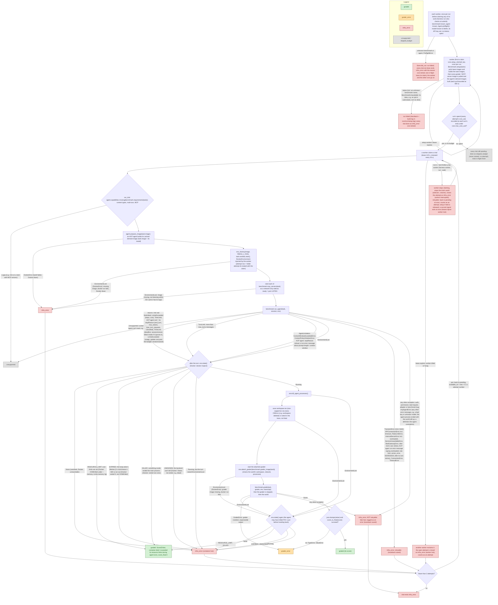

# Error paths in a trial

**Last updated:** 2026-10-30

A living doc: every place a trial can fail, and which outcome it ends in.
Conditions are the code's own (`runner.py`, `worker.py`, `store.py`,
`agents/mini_swe_agent.py`, `environments/docker.py`). The runner sees only the `Environment`
port: `EnvironmentLost` (Docker raises its subclass `DockerError`) and `env.state()`
(`EnvironmentState`: running + `EndReason` once ended: EXPIRED / RESOURCE_LIMIT / KILLED / UNKNOWN; None = gone; the backend translates its own evidence, Docker: `_end_reason()`). Outcome statuses: `task-input.md` → Outcome model.
Update this whenever error handling changes.

Retries, leases and queue-mode setup: Phase 4+5 (`database.md` #12–14).

| Outcome | Counts toward accuracy? | Retried? | Whose fault |
|---|---|---|---|
| `graded` | yes (its `score_float`) | no | nobody's: the agent's result, including failures it caused (killed its container, hit a limit, context full, model refused) |
| `grader_error` | no; reported prominently (count + list) | no | most likely the grader or the benchmark adapter |
| `infra_error` | no | only if `retryable` (2026-10-29 audit): environment lost / Docker errors, network, provider 5xx / overloaded / rate limit, grader failed to start, container lost or lifetime expired, worker lost: up to 3 attempts in total (backoff 5 s × attempt number). Not retried (fail fast, logged as an error): auth / permission, bad request / misconfiguration, any unexpected exception in harness or adapter code; a setup failure | ours: harness, Docker, or our model-provider setup (key, quota, outage) |
| `unsupported` | no; reported separately | no | a capability gap: `AgentCapabilities` vs `Benchmark.requirements(task)` (content types, multi-turn, MCP), checked once before the world starts; or the agent raised `Unsupported` for a message it can't read |
| `skipped_budget` (trial only) | no; reported separately | no | nobody's: the run's `--max-run-cost` was spent before the trial started |

## Notes

- **How mini surfaces model errors.** litellm raises; mini's `LitellmModel.query`
  retries (up to 10 attempts, `MSWEA_MODEL_RETRY_STOP_AFTER_ATTEMPT`) except for
  its abort list (`AuthenticationError`, `PermissionDeniedError`, `NotFoundError`,
  `UnsupportedParamsError`, `ContextWindowExceededError`), then re-raises the
  original exception after logging an `exit` message whose `exit_status` is the
  class name. `ContentPolicyViolationError` is not on the abort list, so mini
  retries it before it reaches us. Our adapter turns the two limitation errors
  into `AgentLimitation` and the transient ones (connection, timeout, rate limit,
  overloaded, 5xx) into `TransientError` (retryable `infra_error`); everything
  else passes through to the runner's catch-all (`infra_error`, not retryable,
  with the traceback).
- **The grader runs in an attached sidecar** (2026-10-29,
  `environment-and-grading.md` #7) from `Benchmark.grader_image(task)`, pre-pulled in
  `setup()`. Nothing is installed at grade time, so grading needs no network and
  `GraderSetupError` is gone (was: `apk add python3` failing → `infra_error`). If the
  grader can't start, that is `EnvironmentLost` → the world's state is checked again
  (rule 6), and if the world still runs → `infra_error`, retried.
- **ACP agents' errors** (2026-10-30, `action-space.md` → Agents over ACP #11): a JSON-RPC error answering
  `session/prompt` carries only a message, so its words decide: overloaded / rate limit / 5xx → `TransientError`
  (retried), prompt too long / context window → `AgentLimitation` (graded as it is), anything else → `AcpAgentError`
  (`infra_error`, not retried); `stopReason: refusal` → `AgentLimitation`. The agent's process ending mid-turn:
  the world gone → `EnvironmentLost` (the runner's death check decides), the world up → `AcpAgentError` with the
  tail of the agent's stderr. The agent's own model-call retries are left alone too. The trace it produced before
  failing is still written (`AgentSession.new_events`, read in a `finally`). (Before 2026-10-30 the dedicated Claude
  Code adapter classified its stream-json result event's error kinds the same way.)
- **mini's own retries are left alone.** mini retries failed model calls
  itself (e.g. `ContentPolicyViolationError` up to 10 times). That is the
  agent's scaffolding, part of what is measured; we don't change it
  (`agents-and-runner.md`). Our retries are whole attempts, for `infra_error` only.
  The trial deadline still holds (2026-10-30): each call, each retry included, gets at most the time left, and a
  call due after the deadline raises `TimeLimit` instead (mini's loop ends as for a command past it: graded).
- **A run that can't run here** (2026-10-30): each worker checks every run once before claiming its work (benchmark
  and agent known, `Agent.preflight()`). A failure fails that run alone (`Store.fail_run`: trials not done end
  `infra_error` with the reason, not retried); the worker starts anyway and the other runs keep flowing, so
  `--exit-when-idle` still exits. (Was: the whole worker refused to start.)
- **Worker interrupted** (Ctrl-C or SIGTERM to `harness worker` / `run --wait`).
  The worker stops claiming, stops the worlds of its trials in flight (with their
  sidecars and volumes), closes each open attempt as a retryable `infra_error`
  ("worker interrupted") and puts the trial back to `pending` at once, so another
  worker takes it; a setup it held is released the same way. The interrupted
  attempt counts toward the 3 (attempt numbers are never reused). A trial thread
  that finishes afterwards no longer holds its claim and its result is discarded;
  a result it reached after the signal is ignored anyway, since Ctrl-C also
  reaches its `docker` commands. Then the worker's row is deleted and it exits 0
  (`run --wait`: 130, the run stays queued). A second signal exits at once: the
  leases then lapse and the trials come back as "worker lost".
- **Worker lost.** A worker renews its trial's lease every 30 s. If it is
  killed (or hangs) the lease expires after 120 s; the next worker to look
  closes the open attempt as `infra_error` ("worker lost") and re-queues the
  trial (or ends it `infra_error` after 3 attempts). The lost attempt counts
  toward the 3, so a trial that kills its worker every time still ends. A late
  write from the lost worker is discarded: finishing an attempt is fenced on
  `claimed_by` + `attempt_count` (`database.md` #19). The heartbeat retries a
  renewal that hit "database is locked". Setup has the same lease: a dead
  setup worker's run is re-claimed by another worker.
- **Spend is always recorded.** The agent's cost, tokens and model calls are
  read from its session at the end of every turn, also a turn it crashed or
  timed out in (`RecordingSession.send`'s `finally`), and written to the
  attempt row at once (`Store.record_spend`, not fenced: money a worker spent
  before losing its claim was still spent; `MAX`, so an outcome without stats,
  e.g. "worker interrupted", never erases it). An ACP agent's cost is the last
  `usage_update` cost it reported (the session's total); one that reports
  tokens but no cost is priced with litellm; a turn killed after ignoring the
  cancel keeps only what was reported before it.
- **Run budget** (`harness run --max-run-cost USD`, `database.md` #22): once
  the run's recorded spend reaches it, no trial of the run is claimed and every
  trial still pending (a retry waiting out its backoff included) ends
  `skipped_budget`. Trials in flight finish under their own per-trial limits,
  so a run can overshoot its budget by what they spend.
- **`harness validate`** reuses `run_trial` unchanged, so every outcome above
  applies; any status other than `graded` (incl. `infra_error`) fails that
  check, with the error's last line in the report. Exit 1 on any failed check.
- **`harness parity`, original side** (`Benchmark.original_workflow`): an
  exception (setup script failed, Docker, the model provider) leaves that one
  run of that task out of the side's accuracy and lists it in the report and
  `parity.json` (`original_errors`), like `infra_error`. Not retried. Its
  containers are removed synchronously in `OriginalAgentWorld.__exit__`.
