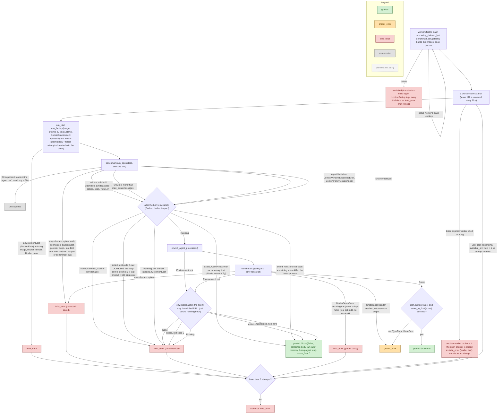

# Error paths in a trial

**Last updated:** 2026-10-29

A living doc: every place a trial can fail, and which outcome it ends in.
Conditions are the code's own (`runner.py`, `worker.py`, `store.py`,
`agents/mini_swe_agent.py`, `environments/docker.py`). The runner sees only the `Environment`
port: `EnvironmentLost` (Docker raises its subclass `DockerError`) and `env.state()`
(`EnvironmentState`: running, exit code, OOM-killed; None = gone). Outcome statuses: `task-input.md` → Outcome model.
Update this whenever error handling changes.

Retries, leases and queue-mode setup: Phase 4+5 (`database.md` #12–14).

| Outcome | Counts toward accuracy? | Retried? | Whose fault |
|---|---|---|---|
| `graded` | yes (its `score_float`) | no | nobody's: the agent's result, including failures it caused (killed its container, hit a limit, context full, model refused) |
| `grader_error` | no; reported prominently (count + list) | no | most likely the grader or the benchmark adapter |
| `infra_error` | no | yes, up to 3 attempts in total (backoff 5 s × attempt number); a setup failure is not retried | ours: harness, Docker, or our model-provider setup (key, quota, outage) |
| `unsupported` | no; reported separately | no | a capability gap: the agent can't take this task's content |

## Notes

- **How mini surfaces model errors.** litellm raises; mini's `LitellmModel.query`
  retries (up to 10 attempts, `MSWEA_MODEL_RETRY_STOP_AFTER_ATTEMPT`) except for
  its abort list (`AuthenticationError`, `PermissionDeniedError`, `NotFoundError`,
  `UnsupportedParamsError`, `ContextWindowExceededError`), then re-raises the
  original exception after logging an `exit` message whose `exit_status` is the
  class name. `ContentPolicyViolationError` is not on the abort list, so mini
  retries it before it reaches us. Our adapter turns the two limitation errors
  into `AgentLimitation`; everything else passes through to the runner's
  catch-all (`infra_error` with the traceback).
- **Grader deps need the network.** bash-operations installs `python3` with
  `apk` at grade time. If that install fails (e.g. no network) the adapter
  raises `GraderSetupError` → `infra_error`, retried: the infrastructure
  failed, not the grader (fix A, 2026-10-29). Phase 6 option B removes the
  network need (`environment-and-grading.md`, known gaps).
- **mini's own retries are left alone.** mini retries failed model calls
  itself (e.g. `ContentPolicyViolationError` up to 10 times). That is the
  agent's scaffolding, part of what is measured; we don't change it
  (`agents-and-runner.md`). Our retries are whole attempts, for `infra_error` only.
- **Worker lost.** A worker renews its trial's lease every 30 s. If it is
  killed (or hangs) the lease expires after 120 s; the next worker to look
  closes the open attempt as `infra_error` ("worker lost") and re-queues the
  trial (or ends it `infra_error` after 3 attempts). The lost attempt counts
  toward the 3, so a trial that kills its worker every time still ends. A late
  write from the lost worker is discarded: finishing an attempt is fenced on
  `claimed_by` + `attempt_count` (`database.md` #19). The heartbeat retries a
  renewal that hit "database is locked". Setup has the same lease: a dead
  setup worker's run is re-claimed by another worker.
