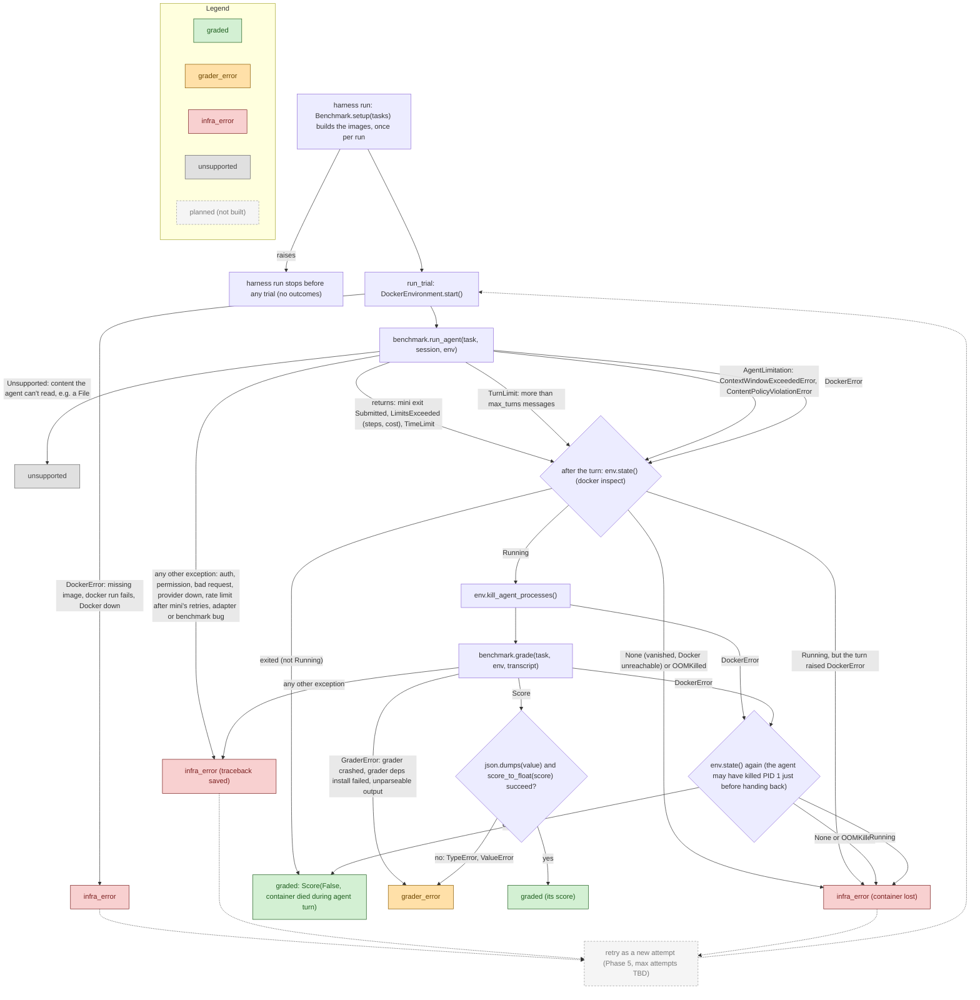

# Error paths in a trial

**Last updated:** 2026-10-29

A living doc: every place a trial can fail, and which outcome it ends in.
Conditions are the code's own (`runner.py`, `agents/mini_swe_agent.py`,
`environments/docker.py`). Outcome statuses: `task-input.md` → Outcome model.
Update this whenever error handling changes.

Dashed arrows and the dashed gray node are planned (Phase 5), not built.

| Outcome | Counts toward accuracy? | Retried? | Whose fault |
|---|---|---|---|
| `graded` | yes (its `score_float`) | no | nobody's: the agent's result, including failures it caused (killed its container, hit a limit, context full, model refused) |
| `grader_error` | no; reported prominently (count + list) | no | most likely the grader or the benchmark adapter |
| `infra_error` | no | yes (Phase 5, planned; max attempts TBD) | ours: harness, Docker, or our model-provider setup (key, quota, outage) |
| `unsupported` | no; reported separately | no | a capability gap: the agent can't take this task's content |

## Notes

- **How mini surfaces model errors.** litellm raises; mini's `LitellmModel.query`
  retries (up to 10 attempts, `MSWEA_MODEL_RETRY_STOP_AFTER_ATTEMPT`) except for
  its abort list (`AuthenticationError`, `PermissionDeniedError`, `NotFoundError`,
  `UnsupportedParamsError`, `ContextWindowExceededError`), then re-raises the
  original exception after logging an `exit` message whose `exit_status` is the
  class name. `ContentPolicyViolationError` is not on the abort list, so mini
  retries it before it reaches us. Our adapter turns the two limitation errors
  into `AgentLimitation`; everything else passes through to the runner's
  catch-all (`infra_error` with the traceback).
- **Grader deps need the network.** bash-operations installs `python3` with
  `apk` at grade time; with no network that is a `GraderError` → `grader_error`.
