# Progress

**Last updated:** 2026-10-30
**Now:** Parts 1–2 and the chosen extensions are built: every phase 0–8, the Claude Code agent, MCP sidecars, cost + time tracking, the dashboard, `validate` / `parity` / `adapt` and the Terminal-Bench proof. Docs checked against the code (2026-10-30). Awaiting Cindy's line-by-line review of everything from Phase 4+5 on.
**Errors:** every failure point and its outcome: [`errors.md`](errors.md).
**Next:** Cindy's review and explain-back; one open question (mini's `environment.env`, which parity showed we drop, [`adapters.md`](adapters.md) → Built); the extensions in [`implementation-plan.md`](implementation-plan.md) → Remaining (gray below).

## Log (newest first)

- 2026-10-30: `harness worker --max-running N` (global cap on running trials across workers, checked inside the claim); mini's model calls capped at the trial's remaining time; `run --concurrency` without `--wait` is a usage error.
- 2026-10-30: one harness-wide model setting: `--model`, else `HARNESS_MODEL`, translated per agent by `Agent.native_model()`; `MSWEA_MODEL_NAME` only for the `mini` CLI examples ([`agents-and-runner.md`](agents-and-runner.md) → Config). Network as a benchmark-declared world property: designed, not built ([`environment.md`](environment.md) → Network).
- 2026-10-30: `TerminalBench` adapter (hello-world, log-summary, sqlite-db-truncate) drafted by `harness adapt`, hand-fixed; validate 3/3 + 3/3 ([`adapters.md`](adapters.md) → Proof).
- 2026-10-29: adapter checks: `harness validate` (NullAgent must fail, OracleAgent applies `Benchmark.reference_solution` and must pass), `harness parity` (baseline C; live bash-operations × mini, 3 runs: 1.000 ± 0 both sides, $0.015), `.claude/skills/add-benchmark/SKILL.md` + `harness adapt`.
- 2026-10-29: cost + time tracking ([`database.md`](database.md) #20–23, schema v4): tokens, model calls and cost per attempt (always recorded), phase timestamps, `--max-run-cost` (`skipped_budget`), live spend in `status`, cost / time metrics in `results`.
- 2026-10-29: `harness dashboard`: read-only local web view (`dashboard.py`, standard-library server on 127.0.0.1, SQLite opened read-only; `dashboard/` React + htm, no build step).
- 2026-10-29: Phase 6 hardening ([`implementation-plan.md`](implementation-plan.md) → Phase 6): results summary by default, graceful Ctrl-C / SIGTERM, `harness cleanup [--all] [--images]`, explicit image pre-pull, repeated pre-grade kill passes, retried volume removal, no-worker warning.
- 2026-10-29: action space + MCP + Claude Code ([`action-space.md`](action-space.md)): `AgentCapabilities` check, MCP servers as network-only sidecars, `exec(env=, user=)`, `ClaudeCode` adapter. Live on Haiku 5.5: bash-operations 0.80, python-tasks 1.00, MCP fixture pass.
- 2026-10-29: grading in an attached grader sidecar ([`environment-and-grading.md`](environment-and-grading.md) #7).
- 2026-10-29: architecture-audit refactor ([`audit-2026-10-29.md`](audit-2026-10-29.md)).
- 2026-10-29: Phase 4+5 merged: database, queue, workers, `status` / `results` ([`database.md`](database.md) #9–19).
- 2026-10-29: Phase 3: agent + trial runner ([`agents-and-runner.md`](agents-and-runner.md)); Phases 0–1 before it.

Legend: 🟩 built / decided and built · 🟨 in progress · 🟥 next up · ⬜ not built · ⬜ dashed border = open question · dashed arrow = decision applies here

```mermaid
flowchart TB
  subgraph P0["Phase 0: get oriented"]
    direction LR
    repo["Repo flattened to root"]
    base["Baseline commit + submodule"]
    notes["Design notes (ideation/)"]
    cmd["CLAUDE.md working rules"]
    ex["Run bash + python examples"]
    read["Read benchmark scripts + DockerEnvironment"]
  end

  subgraph DEC["Decided (environment-and-grading.md, task-input.md, environment.md, security.md, fidelity-vs-integrity.md, agents-and-runner.md)"]
    direction LR
    d_own["Harness owns containers; agents get an Environment handle"]
    d_db["Only the harness writes the DB"]
    d_sleep["Container keep-alive: sleep 3 x trial timeout + 600 s"]
    d_same["Grade in an attached grader sidecar: shares the trial's workspace volume, network, processes (2026-10-29; was same container)"]
    d_pre["Pre-grade: kill leftover agent procs, save workspace.tar, start the grader (grader files only in the grader)"]
    d_out["Outcome: graded / grader_error / infra_error / unsupported (+ skipped_budget per trial); only retryable infra_error retried"]
    d_score["Score → number: Inspect-style default, per-benchmark override"]
    d_grerr["grader_error excluded from accuracy, reported prominently; accuracy = mean over graded only"]
    d_integ["Integrity = trace + saved workspace (fidelity-vs-integrity.md)"]
    d_logs["Exec output streamed to host artifacts"]
    d_deps["Grader tools come from Benchmark.grader_image (pre-pulled); nothing installed at grade time"]
    d_turns["Turn model (benchmark-driven turns)"]
    d_iface["Benchmark API: tasks / setup / run_agent / grade(task, grader, env, transcript)"]
    d_bake["Setup baked into images (D)"]
    d_cred["Credentials: allowlist (forward_env) + redaction"]
    d_env["Environment API: start/stop/exec/write_file/read_file/upload/download"]
    d_metr["METR-style hidden grader assets: unprivileged agent user (designed, not built)"]
    d_net["Network as a benchmark-declared world property (designed 2026-10-30, not built)"]
  end

  subgraph P1["Phase 1: core types + Docker environment + benchmark adapters"]
    direction TB
    types["types.py: Task / Content / Message / Transcript / Score"]
    benchabc["Benchmark ABC (tasks/setup/run_agent/grade)"]
    reg["Benchmark registry"]
    envabc["Environment ABC"]
    dockenv["DockerEnvironment"]
    mount["Workspace: named volume per trial; save_workspace / download"]
    cleanup["Guaranteed cleanup (context manager, labels)"]
    hcleanup["harness cleanup command"]
    bashad["BashOperations adapter"]
    pyad["PythonTasks adapter"]
    oracle["Reference solutions (harness-written) + adapter tests"]
    tasks["harness tasks (not built)"]
  end

  subgraph P3["Phase 3: agent + trial runner (agents-and-runner.md)"]
    direction TB
    subgraph P3D["Decided 2026-10-29"]
      direction LR
      d3_reg["Agent registry AGENTS; --agent = name or path (basename); --model, else HARNESS_MODEL (2026-10-30); versions recorded per run"]
      d3_host["mini runs on host via Python API; env wrapper forwards execute to env.exec; API key never in container"]
      d3_multi["Multi-turn: 2nd send() continues mini's history"]
      d3_reply["Reply = agent's own submission only; exit status kept in records"]
      d3_lim["Limits: deadline in command wrapper + cost/step limits + model-call timeout; 10 min, $1, 50 steps, 60 s/command"]
      d3_dead["Container death in agent turn: EndReason decides infra_error vs graded fail; no --rm"]
      d3_files["Attempt folders: runs/RUN/TASK/attempt-ID/"]
      d3_errs["Error paths (errors.md): AgentLimitation → grade as is; TransientError → retryable infra_error; auth / bugs → infra_error, not retried"]
    end
    agentsess["AgentSession (send)"]
    agentabc["Agent registry + adapters"]
    mini["MiniSweAgent adapter (host, env wrapper, multi-turn)"]
    norm["DockerEnvironment: no --rm, lifetime from trial limit"]
    subgraph TR["Trial runner"]
      direction LR
      startenv["start env"] --> agentph["agent"] --> died["container died?"] --> killleft["kill leftovers"] --> grade["grade"] --> record["write outcome / transcript (trace: events.jsonl as it happens)"] --> stopenv["stop env (always)"]
    end
    fb["Fallbacks: retryable infra_error retried; timeout → graded as is"]
    regrade["harness regrade (not built)"]
    runsync["harness run --wait (was: sync run)"]
  end

  subgraph P4["Phase 4+5 (merged): persistence + status/results"]
    direction TB
    subgraph DB["SQLite"]
      direction LR
      truns[("runs")] --> ttrials[("trials")] --> tatt[("attempts")]
      tatt --> tev[("events")]
    end
    d4_schema["Decided 2026-10-29 (database.md): runs/harness.db, WAL; queue in trials; attempts never overwritten; score raw JSON + score_float; agent-neutral events by turn; files in attempts.artifacts_dir; versions + config per run"]
    traj["Trace: events.jsonl → events (RecordingSession + RecordingEnvironment)"]
    files["Artifacts on disk"]
    status["harness status"]
    results["harness results"]
    q_status["Decided: harness status = active + last hour (--all); --run_id = per-trial table"]
  end

  subgraph P5["Phase 4+5 (merged): queue + workers"]
    direction TB
    enqueue["harness run enqueues"]
    claim["Atomic claim + lease"]
    worker["harness worker --concurrency N"]
    retry["Retry policy: retryable infra_error only"]
    d5_setup["Decided: first worker claims runs.setup_claimed_by, runs setup(), sets run running; setup failure → run failed, trials infra_error"]
    d45["Decided 2026-10-29 (database.md #9–19): run returns id (--wait = inline worker); sqlite3 + handwritten SQL; BEGIN IMMEDIATE claim; 120 s lease, 30 s heartbeat; fenced writes; up to 3 attempts; threads; secret redaction"]
  end

  subgraph AUD["Architecture audit (2026-10-29, audit-2026-10-29.md)"]
    direction TB
    a_port["Environment port: state / kill on the ABC, EnvironmentLost, injected env factory, fake-env runner tests"]
    a_retry["infra_error.retryable: transient only; auth / bad request / bugs fail fast; worker + submit pre-flight"]
    a_life["Lifetime = 3 x trial timeout + 600 s; keep-alive exit 0 = infra_error"]
    a_lim["--memory 2g / --cpus 1 / --pids-limit 512; OOM under our limit = graded fail"]
    a_lazy["Lazy agent registry (status / results never load litellm)"]
    a_rec["RecordingEnvironment: every agent command in the trace"]
    a_cfg["CLI: .env loaded, model resolved at submit, limit flags"]
    a_small["Agent.version / AgentSession.stats; score 0 for harness-decided failures; image content hash; workers table; workspace.tar"]
  end

  subgraph ACT["Action space + MCP + Claude Code (2026-10-29, action-space.md)"]
    direction TB
    x_caps["AgentCapabilities + Benchmark.requirements: one check in the runner → unsupported"]
    x_mcp["Benchmark.mcp_servers: network-only attached sidecars (Environment.attach(Sidecar)); MCP test fixture"]
    x_exec["Environment.exec(env=, user=): docker exec -e NAME (value never on the host command line)"]
    x_cc["ClaudeCode adapter: in-world, cached derived image (prepare_image), --mcp-config, --resume, stream-json trace (new_events)"]
    x_tau["τ²-bench via an MCP sidecar (designed, not built; out of scope)"]
  end

  subgraph P6["Phase 6: hardening (2026-10-29)"]
    direction LR
    prepull["Image pre-pull at run setup (explicit, time-bounded)"]
    p6_stop["Graceful Ctrl-C / SIGTERM: worker interrupted → re-queued"]
    p6_res["results: summary default; wall = first start → last end; queue wait"]
    p6_status["status: warn when trials wait and no worker runs"]
    p6_kill["kill_agent_processes: repeated /proc passes"]
    p6_vol["Volume removal retried; leftovers logged"]
    cost["Cost + time tracking: tokens / calls / cost per attempt (always recorded), phase timestamps, --max-run-cost (skipped_budget), status spend, results metrics (schema v4)"]
    dash["harness dashboard: read-only web view (runs, trials, attempt traces)"]
    breakit["Break-it tests"]
    maxrun["Global cap: worker --max-running N across all workers (2026-10-30)"]
    p6_mtime["mini model calls capped at the trial's remaining time (2026-10-30)"]
    cancel["harness cancel (not built)"]
  end

  subgraph P7["Phase 7: extensions"]
    direction TB
    validate["harness validate"]
    nullor["Null / Oracle agents + Benchmark.reference_solution"]
    skill["Add-benchmark skill + harness adapt"]
    parity["harness parity: baseline C (Benchmark.original_workflow, agent's own Docker mode)"]
    tbench["TerminalBench adapter (3 tasks), drafted by harness adapt, hand-fixed, validates"]
    model["One model setting: --model / HARNESS_MODEL, Agent.native_model (2026-10-30)"]
    origmore["original_workflow for Claude Code and Terminal-Bench (not built)"]
    q_env["Open: mini.yaml environment.env (PAGER=cat ...) dropped by our MiniSweAgent; parity found it"]
  end

  subgraph SCALE["Scale-up (designed, not built)"]
    direction LR
    pipe["Pipelined grading pool"]
    pg["Multi-machine workers: Postgres + SQLAlchemy Core + Alembic"]
    gui["GUI / desktop benchmarks (display + tools beyond the shell)"]
  end

  subgraph P8["Phase 8: deliverables"]
    direction LR
    readme["README: setup, usage, architecture, decisions, extending, limitations"]
    diagram["Architecture diagram: Mermaid in README + docs/architecture.excalidraw + docs/architecture.md"]
  end

  %% flow between pieces
  repo --> base --> notes --> cmd
  ex --> read
  P0 --> P1
  types --> benchabc --> reg
  benchabc --> bashad
  benchabc --> pyad
  bashad --> oracle
  pyad --> oracle
  reg --> tasks
  envabc --> dockenv
  dockenv --> mount --> cleanup --> hcleanup
  dockenv --> bashad
  dockenv --> pyad
  agentsess --> benchabc
  agentsess --> agentabc
  agentabc --> mini
  mini --> agentph
  bashad --> startenv
  pyad --> grade
  dockenv --> startenv
  TR --> fb
  TR --> runsync
  fb -.-> regrade
  record --> tatt
  a_rec --> traj --> tev
  record --> files --> tatt
  ttrials --> status
  tatt --> results
  enqueue --> ttrials
  worker --> claim --> ttrials
  worker --> TR
  claim --> retry
  P5 --> AUD --> ACT --> P6 --> P7 --> P8
  x_caps --> x_mcp --> x_exec --> x_cc -.-> x_tau
  agentabc --> x_cc
  nullor --> validate
  oracle --> nullor
  validate --> skill
  validate -.-> parity
  skill --> tbench
  parity -.-> origmore
  parity -.-> q_env
  P7 -.-> SCALE
  d_own -.-> envabc
  d_own -.-> agentabc
  d_sleep -.-> dockenv
  d_db -.-> record
  d_same -.-> grade
  d_pre -.-> grade
  d_out -.-> fb
  d_out -.-> retry
  d_score -.-> results
  d_grerr -.-> results
  d_integ -.-> traj
  d_integ -.-> files
  d3_reg -.-> agentabc
  d3_reg -.-> runsync
  d3_host -.-> mini
  d3_multi -.-> mini
  d3_reply -.-> mini
  d3_lim -.-> TR
  d3_dead -.-> died
  d3_dead -.-> norm
  d3_files -.-> record
  d3_errs -.-> TR
  d3_errs -.-> retry
  dockenv --> norm
  q_status -.-> status
  d5_setup -.-> enqueue
  d45 -.-> claim
  d45 -.-> worker
  d4_schema -.-> DB
  d_logs -.-> files
  d_deps -.-> grade
  d_turns -.-> TR
  d_iface -.-> benchabc
  d_bake -.-> bashad
  d_bake -.-> pyad
  d_metr -.-> grade
  d_net -.-> dockenv
  d_cred -.-> agentabc
  d_cred -.-> record
  d_env -.-> envabc

  classDef done fill:#d3f0d3,stroke:#1e5e1e,color:#1e5e1e
  classDef wip fill:#fff1b8,stroke:#6b5300,color:#6b5300
  classDef next fill:#f8d0d0,stroke:#7a1f1f,color:#7a1f1f
  classDef todo fill:#ececec,stroke:#999,color:#555
  classDef open fill:#ececec,stroke:#999,color:#555,stroke-dasharray:4 3

  class repo,base,notes,cmd,ex,read done
  class d_own,d_db,d_sleep,d_same,d_pre,d_out,d_logs,d_deps,d_turns,d_iface,d_env,d_bake,d_cred,d_score,d_grerr,d_integ done
  class d3_reg,d3_host,d3_multi,d3_reply,d3_lim,d3_dead,d3_files,d3_errs done
  class types,envabc,benchabc,agentsess,dockenv,mount,cleanup,hcleanup done
  class q_status,d4_schema,d5_setup,d45 done
  class reg,bashad,pyad,oracle done
  class agentabc,mini,norm,startenv,agentph,died,killleft,grade,record,stopenv,runsync,fb done
  class truns,ttrials,tatt,tev,files,status,results,enqueue,claim,worker,retry,traj done
  class a_port,a_retry,a_life,a_lim,a_lazy,a_rec,a_cfg,a_small done
  class x_caps,x_mcp,x_exec,x_cc done
  class prepull,p6_stop,p6_res,p6_status,p6_kill,p6_vol,cost,dash,breakit,maxrun,p6_mtime done
  class validate,nullor,skill,parity,tbench,model done
  class readme,diagram done
  class d_metr,d_net,tasks,regrade,x_tau,cancel,origmore,pipe,pg,gui todo
  class q_env open
```

