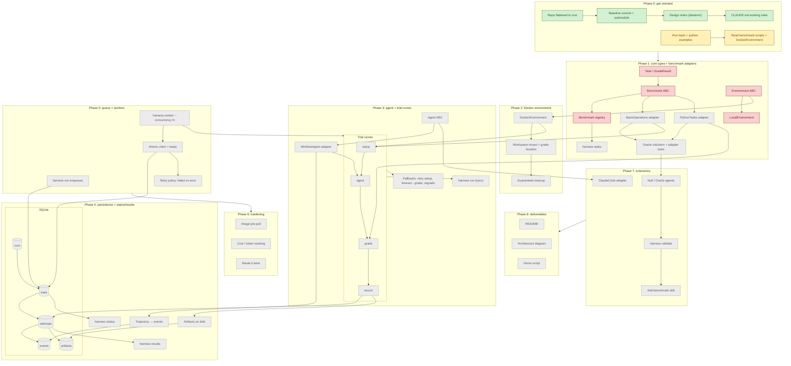

# Progress

**Last updated:** 2026-10-28
**Now:** Phase 0: verifying both examples run, reading benchmark scripts and mini-swe-agent's DockerEnvironment.
**Next:** Phase 1: core types (`Task`, `GradeResult`), `Benchmark` ABC + registry, `Environment` ABC + `LocalEnvironment`.

Legend: 🟩 done · 🟨 in progress · 🟥 next up · ⬜ not started

