# Progress

**Last updated:** 2026-10-29
**Now:** Phase 4 schema design discussion (Phase 3 decisions recorded in `agents-and-runner.md`).
**Next:** Phase 3 build: agent registry, `MiniSweAgent` adapter, trial runner, `harness run` (Claude drafts, Cindy reviews line by line).

Legend: 🟩 done / decided · 🟨 in progress · 🟥 next up · ⬜ not started · ⬜ dashed border = open question · dashed arrow = decision applies here

```mermaid
flowchart TB
  subgraph P0["Phase 0: get oriented"]
    direction LR
    repo["Repo flattened to root"]
    base["Baseline commit + submodule"]
    notes["Design notes (ideation/)"]
    cmd["CLAUDE.md working rules"]
    ex["Run bash + python examples"]
    read["Read benchmark scripts + DockerEnvironment"]
  end

  subgraph DEC["Decided (see environment-and-grading.md, task-input.md, environment.md, security.md, fidelity-vs-integrity.md, agents-and-runner.md)"]
    direction LR
    d_own["Harness owns containers; agents get Environment handle"]
    d_db["Only harness writes DB"]
    d_sleep["Container keep-alive: sleep timeout+margin"]
    d_same["Grade in same trial container"]
    d_pre["Pre-grade: kill leftover agent procs, copy grader files late, install grader deps"]
    d_out["Outcome: graded / grader_error / infra_error / unsupported, infra_error = infra, retried (renamed from error 2026-10-29)"]
    d_score["Score → number: Inspect-style default, per-benchmark override"]
    d_grerr["grader_error excluded from accuracy, reported prominently (count + list); accuracy = mean over graded only (2026-10-29)"]
    d_integ["Integrity = trace + saved workspace (no special mechanism; fidelity-vs-integrity.md)"]
    d_logs["Exec output streamed to host artifacts"]
    d_deps["Grader deps installed at grade time"]
    d_turns["Turn model (benchmark-driven turns)"]
    d_iface["Benchmark API locked: tasks / setup / run_agent / grade"]
    d_bake["Setup baked into images (D)"]
    d_metr["METR-style hidden grader assets"]
    d_cred["Credentials: allowlist + redaction"]
    d_env["Environment API locked: start/stop/exec/write_file/read_file/upload/download"]
  end

  subgraph P1["Phase 1: core types + Docker environment + benchmark adapters"]
    direction TB
    types["types.py: Task / Content / Message / Transcript / Score"]
    benchabc["Benchmark ABC (tasks/setup/run_agent/grade)"]
    reg["Benchmark registry"]
    envabc["Environment ABC"]
    dockenv["DockerEnvironment"]
    mount["Workspace in container + download"]
    cleanup["Guaranteed cleanup (context manager, labels)"]
    hcleanup["harness cleanup command"]
    bashad["BashOperations adapter"]
    pyad["PythonTasks adapter"]
    oracle["Oracle solutions + adapter tests"]
    tasks["harness tasks"]
  end

  subgraph P3["Phase 3: agent + trial runner (agents-and-runner.md)"]
    direction TB
    subgraph P3D["Decided 2026-10-29"]
      direction LR
      d3_reg["Agent registry AGENTS; --agent = name or path (basename); --model overrides .env; record agent, model, submodule SHA per run"]
      d3_host["mini runs on host via Python API; env wrapper forwards execute to env.exec; API key never in container"]
      d3_multi["Multi-turn built now: 2nd send() continues mini's history"]
      d3_reply["Reply = agent's own submission only; mini exit status kept in records"]
      d3_lim["Limits: deadline in command wrapper + mini cost/step + model-call timeout; 10 min, $1, 50 steps, 60 s/command; lifetime = timeout + margin"]
      d3_dead["Container death in agent turn: docker inspect decides infra_error vs graded-failed; drop --rm"]
      d3_files["Until DB: runs/run_id/trial_id/attempt-n/ (outcome, transcript, trajectory)"]
    end
    agentsess["AgentSession stub (send)"]
    agentabc["Agent registry + adapters"]
    mini["MiniSweAgent adapter (host, env wrapper, multi-turn)"]
    norm["DockerEnvironment: drop --rm, lifetime from trial limit"]
    subgraph TR["Trial runner"]
      direction LR
      startenv["start env"] --> agentph["agent"] --> died["container died?"] --> killleft["kill leftovers"] --> grade["grade"] --> record["write outcome / transcript / trace"] --> stopenv["stop env (always)"]
    end
    fb["Fallbacks: retry start env, timeout→grade, regrade"]
    runsync["harness run (sync)"]
  end

  subgraph P4["Phase 4: persistence + status/results"]
    direction TB
    subgraph DB["SQLite"]
      direction LR
      truns[("runs")] --> ttrials[("trials")] --> tatt[("attempts")]
      tatt --> tev[("events")]
      tatt --> tart[("artifacts")]
    end
    traj["Trajectory → events"]
    files["Artifacts on disk"]
    status["harness status"]
    results["harness results"]
    q_status["OPEN: harness status: one run (--run_id) vs list active runs"]
  end

  subgraph P5["Phase 5: queue + workers"]
    direction TB
    enqueue["harness run enqueues"]
    claim["Atomic claim + lease"]
    worker["harness worker --concurrency N"]
    retry["Retry policy: retry infra_error only"]
    q_setup["OPEN: who calls Benchmark.setup() in queue mode? (one worker claims a per-run setup step)"]
  end

  subgraph P6["Phase 6: hardening"]
    direction LR
    prepull["Image pre-pull"]
    cost["Cost / token tracking"]
    breakit["Break-it tests"]
  end

  subgraph P7["Phase 7: extensions"]
    direction TB
    claude["ClaudeCode adapter"]
    validate["harness validate"]
    nullor["Null / Oracle agents"]
    skill["Add-benchmark skill"]
    parity["harness parity (out of scope)"]
  end

  subgraph P8["Phase 8: deliverables"]
    direction LR
    readme["README"]
    diagram["Architecture diagram"]
    demo["Demo script"]
  end

  %% flow between pieces
  repo --> base --> notes --> cmd
  ex --> read
  P0 --> P1
  types --> benchabc --> reg
  benchabc --> bashad
  benchabc --> pyad
  bashad --> oracle
  pyad --> oracle
  reg --> tasks
  envabc --> dockenv
  dockenv --> mount --> cleanup --> hcleanup
  dockenv --> bashad
  dockenv --> pyad
  agentsess --> benchabc
  agentsess --> agentabc
  agentabc --> mini
  mini --> agentph
  bashad --> startenv
  pyad --> grade
  dockenv --> startenv
  TR --> fb
  TR --> runsync
  record --> tatt
  mini --> traj --> tev
  record --> files --> tart
  ttrials --> status
  tatt --> results
  enqueue --> ttrials
  worker --> claim --> ttrials
  worker --> TR
  claim --> retry
  P5 --> P6
  agentabc --> claude
  nullor --> validate
  oracle --> nullor
  validate --> skill
  validate -.-> parity
  P7 --> P8
  d_own -.-> envabc
  d_own -.-> agentabc
  d_sleep -.-> dockenv
  d_db -.-> record
  d_same -.-> grade
  d_pre -.-> grade
  d_out -.-> fb
  d_out -.-> retry
  d_score -.-> results
  d_grerr -.-> results
  d_integ -.-> traj
  d_integ -.-> files
  d3_reg -.-> agentabc
  d3_reg -.-> runsync
  d3_host -.-> mini
  d3_multi -.-> mini
  d3_reply -.-> mini
  d3_lim -.-> TR
  d3_dead -.-> died
  d3_dead -.-> norm
  d3_files -.-> record
  dockenv --> norm
  q_status -.-> status
  q_setup -.-> enqueue
  d_logs -.-> files
  d_deps -.-> grade
  d_turns -.-> TR
  d_iface -.-> benchabc
  d_bake -.-> bashad
  d_bake -.-> pyad
  d_metr -.-> grade
  d_cred -.-> agentabc
  d_cred -.-> record
  d_env -.-> envabc

  classDef done fill:#d3f0d3,stroke:#1e5e1e,color:#1e5e1e
  classDef wip fill:#fff1b8,stroke:#6b5300,color:#6b5300
  classDef next fill:#f8d0d0,stroke:#7a1f1f,color:#7a1f1f
  classDef todo fill:#ececec,stroke:#999,color:#555
  classDef open fill:#ececec,stroke:#999,color:#555,stroke-dasharray:4 3

  class repo,base,notes,cmd,ex,read done
  class d_own,d_db,d_sleep,d_same,d_pre,d_out,d_logs,d_deps,d_turns,d_iface,d_env,d_bake,d_metr,d_cred,d_score,d_grerr,d_integ done
  class d3_reg,d3_host,d3_multi,d3_reply,d3_lim,d3_dead,d3_files done
  class types,envabc,benchabc,agentsess,dockenv,mount,cleanup done
  class q_status,q_setup open
  class reg,bashad,pyad,oracle done
  class agentabc,mini,norm,startenv,agentph,died,killleft,grade,record,stopenv,runsync next
  class tasks,hcleanup,fb,truns,ttrials,tatt,tev,tart,traj,files,status,results,enqueue,claim,worker,retry,prepull,cost,breakit,claude,validate,nullor,skill,parity,readme,diagram,demo todo
```

