# Progress

**Last updated:** 2026-10-29
**Now:** cost + time tracking built (2026-10-29, `database.md` #20–23): agents report tokens, model calls and cost (also on error / timeout / interrupt; recorded at each turn's end), per-attempt phase timestamps, `harness run --max-run-cost` (waiting trials end `skipped_budget`), `status` live spend + elapsed, `results` cost per task / per passing task, tokens, time breakdown. Schema v4: an older `runs/harness.db` must be deleted. Awaiting Cindy's review. Before that: `harness dashboard` built (2026-10-29): a read-only local web view (`dashboard.py`, standard-library server on 127.0.0.1, SQLite opened `mode=ro`; `dashboard/` React + htm, no build step) of runs, trials, attempts and traces, polling every 2 s. Awaiting Cindy's review. Before that: Phase 6 hardening built (2026-10-29, `implementation-plan.md` → Phase 6): `harness results` summary by default with wall time and queue wait, graceful Ctrl-C / SIGTERM (trials handed back as "worker interrupted"), `harness cleanup [--all] [--images]`, explicit time-bounded image pre-pull at run setup, repeated pre-grade kill passes, retried volume removal, `status` no-worker warning. Schema v3 (`attempts.started_at` / `finished_at`): an older `runs/harness.db` must be deleted. Awaiting Cindy's review. Before that: action space + MCP + Claude Code built (2026-10-29, [`action-space.md`](action-space.md)): one `AgentCapabilities` check in the runner, MCP servers as network-only attached sidecars (`Benchmark.mcp_servers`, `Environment.attach(Sidecar)`), `exec(env=, user=)`, `ClaudeCode` adapter (in-world, cached derived image, `--mcp-config`, stream-json trace). Live on Haiku 5.5: bash-operations 0.80, python-tasks 1.00, MCP fixture pass. Awaiting Cindy's review. τ²-bench: designed, not built (out of scope). Before that: general grading via an attached grader sidecar built (2026-10-29, `environment-and-grading.md` #7): workspace volume per trial, `Environment.attach_grader`, `Benchmark.grader_image`, `grade(task, grader, env, transcript)`, no grade-time installs, grader files never in the world. Awaiting Cindy's review. Before that: architecture-audit refactor built (2026-10-29, [`audit-2026-10-29.md`](audit-2026-10-29.md)): Environment port + injected factory, retryable `infra_error` + pre-flight, resource limits, lifetime rule, lazy agent registry, command trace, CLI config, workers table, saved workspace. Awaiting Cindy's review. Before that: Phase 4+5 built (merged 2026-10-29: database + queue + workers + status/results; `database.md` #9–19): `store.py`, `worker.py`, `redact.py`, `harness run [--wait]` / `worker` / `status` / `results`; fake-agent tests green. Awaiting Cindy's line-by-line review.
**Errors:** every failure point and its outcome: [`errors.md`](errors.md) (agent exceptions classified by cause; container-death race fixed, 2026-10-29).
**Next:** `harness cancel` (Phase 6 leftover); Phase 7 extensions.

Legend: 🟩 done / decided · 🟨 in progress · 🟥 next up · ⬜ not started · ⬜ dashed border = open question · dashed arrow = decision applies here

```mermaid
flowchart TB
  subgraph P0["Phase 0: get oriented"]
    direction LR
    repo["Repo flattened to root"]
    base["Baseline commit + submodule"]
    notes["Design notes (ideation/)"]
    cmd["CLAUDE.md working rules"]
    ex["Run bash + python examples"]
    read["Read benchmark scripts + DockerEnvironment"]
  end

  subgraph DEC["Decided (see environment-and-grading.md, task-input.md, environment.md, security.md, fidelity-vs-integrity.md, agents-and-runner.md)"]
    direction LR
    d_own["Harness owns containers; agents get Environment handle"]
    d_db["Only harness writes DB"]
    d_sleep["Container keep-alive: sleep timeout+margin"]
    d_same["Grade in an attached grader sidecar: shares the trial's workspace volume, network, processes (2026-10-29; was same container)"]
    d_pre["Pre-grade: kill leftover agent procs, save workspace.tar, start the grader (grader files only in the grader)"]
    d_out["Outcome: graded / grader_error / infra_error / unsupported, infra_error = infra, retried (renamed from error 2026-10-29)"]
    d_score["Score → number: Inspect-style default, per-benchmark override"]
    d_grerr["grader_error excluded from accuracy, reported prominently (count + list); accuracy = mean over graded only (2026-10-29)"]
    d_integ["Integrity = trace + saved workspace (no special mechanism; fidelity-vs-integrity.md)"]
    d_logs["Exec output streamed to host artifacts"]
    d_deps["Grader tools come from Benchmark.grader_image (pre-pulled in setup); nothing installed at grade time (2026-10-29)"]
    d_turns["Turn model (benchmark-driven turns)"]
    d_iface["Benchmark API locked: tasks / setup / run_agent / grade"]
    d_bake["Setup baked into images (D)"]
    d_metr["METR-style hidden grader assets"]
    d_cred["Credentials: allowlist + redaction"]
    d_env["Environment API locked: start/stop/exec/write_file/read_file/upload/download"]
  end

  subgraph P1["Phase 1: core types + Docker environment + benchmark adapters"]
    direction TB
    types["types.py: Task / Content / Message / Transcript / Score"]
    benchabc["Benchmark ABC (tasks/setup/run_agent/grade)"]
    reg["Benchmark registry"]
    envabc["Environment ABC"]
    dockenv["DockerEnvironment"]
    mount["Workspace in container + download"]
    cleanup["Guaranteed cleanup (context manager, labels)"]
    hcleanup["harness cleanup command"]
    bashad["BashOperations adapter"]
    pyad["PythonTasks adapter"]
    oracle["Oracle solutions + adapter tests"]
    tasks["harness tasks"]
  end

  subgraph P3["Phase 3: agent + trial runner (agents-and-runner.md)"]
    direction TB
    subgraph P3D["Decided 2026-10-29"]
      direction LR
      d3_reg["Agent registry AGENTS; --agent = name or path (basename); --model overrides .env; record agent, model, submodule SHA per run"]
      d3_host["mini runs on host via Python API; env wrapper forwards execute to env.exec; API key never in container"]
      d3_multi["Multi-turn built now: 2nd send() continues mini's history"]
      d3_reply["Reply = agent's own submission only; mini exit status kept in records"]
      d3_lim["Limits: deadline in command wrapper + mini cost/step + model-call timeout; 10 min, $1, 50 steps, 60 s/command; lifetime = timeout + margin"]
      d3_dead["Container death in agent turn: docker inspect decides infra_error vs graded-failed; drop --rm"]
      d3_files["Until DB: runs/run_id/trial_id/attempt-n/ (outcome, transcript, trajectory)"]
      d3_errs["Error paths (errors.md): AgentLimitation (context full, model refused) → grade as is; provider/auth/unknown → infra_error; grading DockerError → re-check container state"]
    end
    agentsess["AgentSession stub (send)"]
    agentabc["Agent registry + adapters"]
    mini["MiniSweAgent adapter (host, env wrapper, multi-turn)"]
    norm["DockerEnvironment: drop --rm, lifetime from trial limit"]
    subgraph TR["Trial runner"]
      direction LR
      startenv["start env"] --> agentph["agent"] --> died["container died?"] --> killleft["kill leftovers"] --> grade["grade"] --> record["write outcome / transcript (trace: events.jsonl as it happens)"] --> stopenv["stop env (always)"]
    end
    fb["Fallbacks: retry start env, timeout→grade, regrade"]
    runsync["harness run (sync)"]
  end

  subgraph P4["Phase 4+5 (merged): persistence + status/results"]
    direction TB
    subgraph DB["SQLite"]
      direction LR
      truns[("runs")] --> ttrials[("trials")] --> tatt[("attempts")]
      tatt --> tev[("events")]
    end
    d4_schema["Decided 2026-10-29 (database.md): runs/harness.db, WAL; queue in trials; attempts never overwritten; score raw JSON + score_float; agent-neutral events by turn; files in attempts.artifacts_dir (no artifacts table); versions + config per run"]
    traj["Trace: events.jsonl → events (RecordingSession + RecordingEnvironment)"]
    files["Artifacts on disk"]
    status["harness status"]
    results["harness results"]
    q_status["Decided: harness status = active + last hour (--all); --run_id = per-trial table"]
  end

  subgraph P5["Phase 4+5 (merged): queue + workers"]
    direction TB
    enqueue["harness run enqueues"]
    claim["Atomic claim + lease"]
    worker["harness worker --concurrency N"]
    retry["Retry policy: retry infra_error only"]
    d5_setup["Decided: first worker claims runs.setup_claimed_by, runs setup(), sets run running; trials claimable only then; setup failure → run failed, trials infra_error"]
    d45["Decided 2026-10-29 (database.md #9–18): run returns id (--wait = inline worker); sqlite3 + handwritten SQL in store.py; BEGIN IMMEDIATE claim; 120 s lease renewed every 30 s; infra_error retried up to 3 attempts; worker threads; events.jsonl → events per turn; secret redaction; grader that can't start → infra_error"]
  end

  subgraph AUD["Architecture audit (2026-10-29, audit-2026-10-29.md)"]
    direction TB
    a_port["Environment port: state / kill on the ABC, EnvironmentLost, injected env factory, fake-env runner tests"]
    a_retry["infra_error.retryable: transient only; auth / bad request / bugs fail fast; worker + submit pre-flight"]
    a_life["Lifetime = 3 x trial timeout + 600 s; keep-alive exit 0 = infra_error"]
    a_lim["--memory 2g / --cpus 1 / --pids-limit 512; OOM under our limit = graded fail"]
    a_lazy["Lazy agent registry (status / results never load litellm)"]
    a_rec["RecordingEnvironment: every agent command in the trace"]
    a_cfg["CLI: .env loaded, model resolved at submit, limit flags"]
    a_small["Agent.version / AgentSession.stats; score 0 for harness-decided failures; image content hash; workers table; workspace.tar"]
  end

  subgraph ACT["Action space + MCP + Claude Code (2026-10-29, action-space.md)"]
    direction TB
    x_caps["AgentCapabilities + Benchmark.requirements: one check in the runner → unsupported"]
    x_mcp["Benchmark.mcp_servers: network-only attached sidecars (Environment.attach(Sidecar)); MCP test fixture"]
    x_exec["Environment.exec(env=, user=): docker exec -e NAME (value never on the host command line)"]
    x_cc["ClaudeCode adapter: in-world, cached derived image (prepare_image), --mcp-config, --resume, stream-json trace (new_events)"]
    x_tau["τ²-bench via an MCP sidecar (designed, not built; out of scope)"]
  end

  subgraph P6["Phase 6: hardening (2026-10-29)"]
    direction LR
    prepull["Image pre-pull at run setup (explicit, time-bounded)"]
    p6_stop["Graceful Ctrl-C / SIGTERM: worker interrupted → re-queued"]
    p6_res["results: summary default; wall = first start → last end; queue wait"]
    p6_status["status: warn when trials wait and no worker runs"]
    p6_kill["kill_agent_processes: repeated /proc passes"]
    p6_vol["Volume removal retried; leftovers logged"]
    cost["Cost + time tracking: tokens / calls / cost per attempt (always recorded), phase timestamps, --max-run-cost (skipped_budget), status spend, results metrics (schema v4)"]
    cancel["harness cancel"]
    dash["harness dashboard: read-only web view (runs, trials, attempt traces)"]
    breakit["Break-it tests"]
  end

  subgraph P7["Phase 7: extensions"]
    direction TB
    claude["ClaudeCode adapter"]
    validate["harness validate"]
    nullor["Null / Oracle agents"]
    skill["Add-benchmark skill"]
    parity["harness parity (out of scope)"]
  end

  subgraph P8["Phase 8: deliverables"]
    direction LR
    readme["README: setup, usage, architecture, decisions, extending, limitations"]
    diagram["Architecture diagram: Mermaid in README + docs/architecture.excalidraw + docs/architecture.md"]
  end

  %% flow between pieces
  repo --> base --> notes --> cmd
  ex --> read
  P0 --> P1
  types --> benchabc --> reg
  benchabc --> bashad
  benchabc --> pyad
  bashad --> oracle
  pyad --> oracle
  reg --> tasks
  envabc --> dockenv
  dockenv --> mount --> cleanup --> hcleanup
  dockenv --> bashad
  dockenv --> pyad
  agentsess --> benchabc
  agentsess --> agentabc
  agentabc --> mini
  mini --> agentph
  bashad --> startenv
  pyad --> grade
  dockenv --> startenv
  TR --> fb
  TR --> runsync
  record --> tatt
  a_rec --> traj --> tev
  record --> files --> tatt
  ttrials --> status
  tatt --> results
  enqueue --> ttrials
  worker --> claim --> ttrials
  worker --> TR
  claim --> retry
  P5 --> AUD --> ACT --> P6
  x_caps --> x_mcp --> x_exec --> x_cc -.-> x_tau
  agentabc --> claude
  nullor --> validate
  oracle --> nullor
  validate --> skill
  validate -.-> parity
  P7 --> P8
  d_own -.-> envabc
  d_own -.-> agentabc
  d_sleep -.-> dockenv
  d_db -.-> record
  d_same -.-> grade
  d_pre -.-> grade
  d_out -.-> fb
  d_out -.-> retry
  d_score -.-> results
  d_grerr -.-> results
  d_integ -.-> traj
  d_integ -.-> files
  d3_reg -.-> agentabc
  d3_reg -.-> runsync
  d3_host -.-> mini
  d3_multi -.-> mini
  d3_reply -.-> mini
  d3_lim -.-> TR
  d3_dead -.-> died
  d3_dead -.-> norm
  d3_files -.-> record
  d3_errs -.-> TR
  d3_errs -.-> retry
  dockenv --> norm
  q_status -.-> status
  d5_setup -.-> enqueue
  d45 -.-> claim
  d45 -.-> worker
  d4_schema -.-> DB
  d_logs -.-> files
  d_deps -.-> grade
  d_turns -.-> TR
  d_iface -.-> benchabc
  d_bake -.-> bashad
  d_bake -.-> pyad
  d_metr -.-> grade
  d_cred -.-> agentabc
  d_cred -.-> record
  d_env -.-> envabc

  classDef done fill:#d3f0d3,stroke:#1e5e1e,color:#1e5e1e
  classDef wip fill:#fff1b8,stroke:#6b5300,color:#6b5300
  classDef next fill:#f8d0d0,stroke:#7a1f1f,color:#7a1f1f
  classDef todo fill:#ececec,stroke:#999,color:#555
  classDef open fill:#ececec,stroke:#999,color:#555,stroke-dasharray:4 3

  class repo,base,notes,cmd,ex,read done
  class d_own,d_db,d_sleep,d_same,d_pre,d_out,d_logs,d_deps,d_turns,d_iface,d_env,d_bake,d_metr,d_cred,d_score,d_grerr,d_integ done
  class d3_reg,d3_host,d3_multi,d3_reply,d3_lim,d3_dead,d3_files,d3_errs done
  class types,envabc,benchabc,agentsess,dockenv,mount,cleanup done
  class q_status,d4_schema,d5_setup,d45 done
  class reg,bashad,pyad,oracle done
  class agentabc,mini,norm,startenv,agentph,died,killleft,grade,record,stopenv,runsync done
  class truns,ttrials,tatt,tev,files,status,results,enqueue,claim,worker,retry done
  class traj done
  class a_port,a_retry,a_life,a_lim,a_lazy,a_rec,a_cfg,a_small done
  class readme,diagram done
  class x_caps,x_mcp,x_exec,x_cc,claude done
  class x_tau open
  class hcleanup,prepull,p6_stop,p6_res,p6_status,p6_kill,p6_vol,breakit,dash,cost done
  class tasks,fb,cancel,validate,nullor,skill,parity todo
```

