# Progress

**Last updated:** 2026-10-29
**Now:** Phase 1: `Benchmark` ABC + `Environment` ABC.
**Next:** Phase 1: `BashOperations` + `PythonTasks` adapters.

Legend: 🟩 done / decided · 🟨 in progress · 🟥 next up · ⬜ not started · dashed arrow = decision applies here

```mermaid
flowchart TB
  subgraph P0["Phase 0: get oriented"]
    direction LR
    repo["Repo flattened to root"]
    base["Baseline commit + submodule"]
    notes["Design notes (ideation/)"]
    cmd["CLAUDE.md working rules"]
    ex["Run bash + python examples"]
    read["Read benchmark scripts + DockerEnvironment"]
  end

  subgraph DEC["Decided (see environment-and-grading.md, task-input.md)"]
    direction LR
    d_own["Harness owns containers; agents get Environment handle"]
    d_db["Only harness writes DB"]
    d_sleep["Container keep-alive: sleep timeout+margin"]
    d_same["Grade in same trial container"]
    d_pre["Pre-grade: kill agent procs, late copy, restore tests, install deps"]
    d_out["Grader crash → failed (grader_error); container death → error"]
    d_logs["Exec output streamed to host artifacts"]
    d_deps["Grader deps installed at grade time"]
    d_episode["Episode model (benchmark-driven turns)"]
    d_iface["Benchmark API locked: tasks / build_world / run_agent / grade"]
  end

  subgraph P1["Phase 1: core types + benchmark adapters"]
    direction TB
    types["types.py: Task / Content / Message / Transcript / Score"]
    benchabc["Benchmark ABC"]
    reg["Benchmark registry"]
    envabc["Environment ABC"]
    localenv["LocalEnvironment"]
    bashad["BashOperations adapter"]
    pyad["PythonTasks adapter"]
    oracle["Oracle solutions + adapter tests"]
    tasks["harness tasks"]
  end

  subgraph P2["Phase 2: Docker environment"]
    direction TB
    dockenv["DockerEnvironment"]
    mount["Workspace mount"]
    cleanup["Guaranteed cleanup"]
  end

  subgraph P3["Phase 3: agent + trial runner"]
    direction TB
    agentabc["Agent ABC"]
    mini["MiniSweAgent adapter"]
    subgraph TR["Trial runner"]
      direction LR
      setup["setup"] --> agentph["agent"] --> grade["grade"] --> record["record"]
    end
    fb["Fallbacks: retry setup, timeout→grade, regrade"]
    runsync["harness run (sync)"]
  end

  subgraph P4["Phase 4: persistence + status/results"]
    direction TB
    subgraph DB["SQLite"]
      direction LR
      truns[("runs")] --> ttrials[("trials")] --> tatt[("attempts")]
      tatt --> tev[("events")]
      tatt --> tart[("artifacts")]
    end
    traj["Trajectory → events"]
    files["Artifacts on disk"]
    status["harness status"]
    results["harness results"]
  end

  subgraph P5["Phase 5: queue + workers"]
    direction TB
    enqueue["harness run enqueues"]
    claim["Atomic claim + lease"]
    worker["harness worker --concurrency N"]
    retry["Retry policy: failed vs error"]
  end

  subgraph P6["Phase 6: hardening"]
    direction LR
    prepull["Image pre-pull"]
    cost["Cost / token tracking"]
    breakit["Break-it tests"]
  end

  subgraph P7["Phase 7: extensions"]
    direction TB
    claude["ClaudeCode adapter"]
    validate["harness validate"]
    nullor["Null / Oracle agents"]
    skill["Add-benchmark skill"]
    parity["harness parity (out of scope)"]
  end

  subgraph P8["Phase 8: deliverables"]
    direction LR
    readme["README"]
    diagram["Architecture diagram"]
    demo["Demo script"]
  end

  %% flow between pieces
  repo --> base --> notes --> cmd
  ex --> read
  P0 --> P1
  types --> benchabc --> reg
  benchabc --> bashad
  benchabc --> pyad
  envabc --> localenv
  bashad --> oracle
  pyad --> oracle
  reg --> tasks
  envabc --> dockenv
  dockenv --> mount --> cleanup
  agentabc --> mini
  mini --> agentph
  bashad --> setup
  pyad --> grade
  dockenv --> setup
  TR --> fb
  TR --> runsync
  record --> tatt
  mini --> traj --> tev
  record --> files --> tart
  ttrials --> status
  tatt --> results
  enqueue --> ttrials
  worker --> claim --> ttrials
  worker --> TR
  claim --> retry
  P5 --> P6
  agentabc --> claude
  nullor --> validate
  oracle --> nullor
  validate --> skill
  validate -.-> parity
  P7 --> P8
  d_own -.-> envabc
  d_own -.-> agentabc
  d_sleep -.-> dockenv
  d_db -.-> record
  d_same -.-> grade
  d_pre -.-> grade
  d_out -.-> fb
  d_logs -.-> files
  d_deps -.-> grade
  d_episode -.-> TR
  d_iface -.-> benchabc

  classDef done fill:#d3f0d3,stroke:#1e5e1e,color:#1e5e1e
  classDef wip fill:#fff1b8,stroke:#6b5300,color:#6b5300
  classDef next fill:#f8d0d0,stroke:#7a1f1f,color:#7a1f1f
  classDef todo fill:#ececec,stroke:#999,color:#555

  class repo,base,notes,cmd,ex,read done
  class d_own,d_db,d_sleep,d_same,d_pre,d_out,d_logs,d_deps,d_episode,d_iface done
  class types done
  class benchabc,reg,envabc,localenv wip
  class bashad,pyad,oracle next
  class tasks,dockenv,mount,cleanup,agentabc,mini,setup,agentph,grade,record,fb,runsync,truns,ttrials,tatt,tev,tart,traj,files,status,results,enqueue,claim,worker,retry,prepull,cost,breakit,claude,validate,nullor,skill,parity,readme,diagram,demo todo
```

